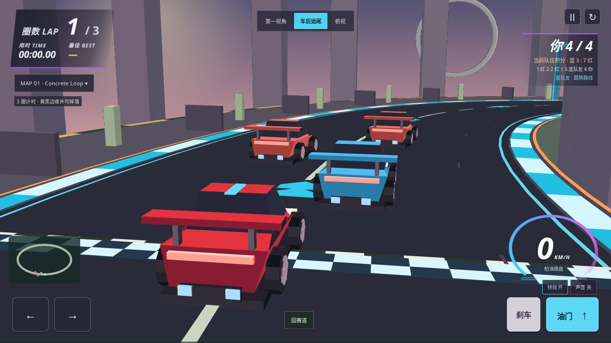
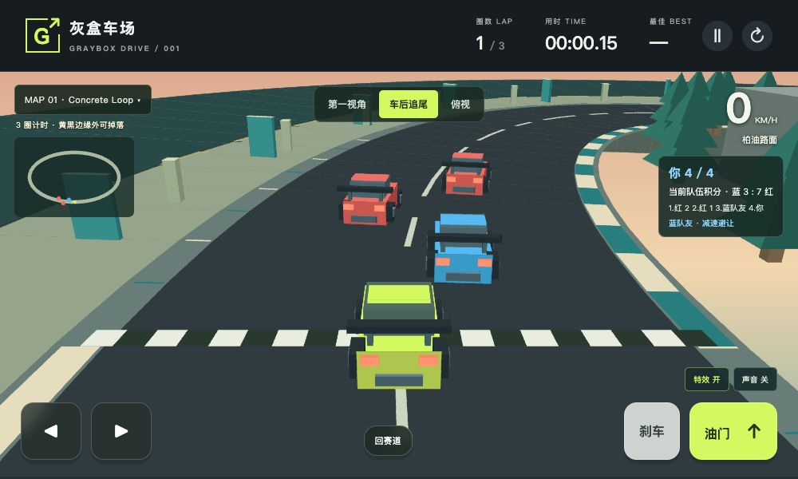

# 灰盒车场 Graybox Drive

一个免费、免登录、无需安装的手机浏览器驾驶小游戏。所有游戏逻辑在浏览器本地运行，没有 API 或服务器费用。

## 免费游玩

[打开游戏](https://liushiyumath.github.io/graybox-drive/) · [直接玩 Mountain Road](https://liushiyumath.github.io/graybox-drive/?map=mountain)

手机建议横屏。左手控制方向，右手控制油门和刹车。支持第一视角、车后追尾和俯视视角，可以在驾驶中切换。

| 操作 | 手机 | 电脑 |
| --- | --- | --- |
| 转向 | ◀ / ▶ | A / D 或方向键 |
| 加速 | 油门 | W 或 ↑ |
| 刹车和倒车 | 刹车 | S / ↓ / Space |
| 切换视角 | 顶部视角按钮 | V |
| 回到赛道 | 回赛道按钮 | R |
| 暂停 | 暂停按钮 | Escape |

## 原始赛车概念图落地

Map 01 已加入暮色城市、环形地标、红色跑车、圆形轮胎、蓝色门架和橙色导向。新追尾镜头提供较低的车后三分之四视角；五张地图均保留三种视角、触控驾驶、2v2 与原有计时规则。

车身反馈、漂移烟雾、地面胎痕、腾空计时与完赛反馈读取实际游戏状态。蓝色路面箭头是行驶方向提示。速度和排名显示真实数值。



[提交前验收与真实画面](verification/concept-release/verification.md) · [四张原始概念图与实机对照 Page](https://chatgpt.com/space/page_250e5db70e1c8191906045b0cd11e64d) · [制作范围与差异](docs/CONCEPT-FIDELITY.md)

当前程序化画面仍采用风格化着色。原图中的写实反射、8 车、300+ km/h 和 Boost 奖励不作为已实现功能。

## 首轮美术切片历史证据

Map 01 采用石墨色赛道、青绿色路肩、暖色天空和低多边形环境。主车与电脑车有轮胎、灯组、尾翼和车身细节。驾驶规则、五图、三视角和 2v2 保持一致。

撞击火花、轮胎烟雾、检查点提示和完赛庆祝读取实际游戏状态。右下角可切换低特效。声音默认关闭，点击“声音 开”后，引擎音随车速变化。暂停和切到后台会静音。



[82 秒完整实机录像](verification/slice/full-race.mp4) · [8 秒实机剪辑](verification/slice/highlights-8s.mp4)。完整录像包含准备和 66.50 秒自然三圈比赛；8 秒版为三段剪辑。两者只含画面，实际音频波形与暂停静音另经验证。

运行版 `41bd106` 的提交前、Linux 和正式站完整验证均 PASS：三轮各 551 张截图、8 段录像，61 项已测源码一致，10 个线上资源匹配。[发布流水线](https://github.com/LiuShiyuMath/graybox-drive/actions/runs/42831782524) · [机器可读验收](verification/slice/release.json)。

[基线、Paintover、制作范围](docs/VERTICAL-SLICE.md) · [本轮验收与真实媒体](verification/slice/verification.md)。Paintover 仅是视觉目标，运行图是实际游戏截图。第一轮为程序化、平面着色的风格样板，写实资产和手机真机验收保持待完成。

## 地图

| 地图 | 路线 | 挑战 |
| --- | --- | --- |
| Map 01 — Concrete Loop | 原有环形赛道，三圈计时 | 路肩、缓冲区、建筑碰撞和外侧掉落 |
| Map 02 — Mountain Road | 约 716 m 山脚至山顶，实际爬升 102 m | 连续 S 弯、坡道、左侧山壁、右侧悬崖及 5 个检查点 |
| [Map 03 — Proving Ground](https://liushiyumath.github.io/graybox-drive/?map=proving) | 驾驶测试场，三圈计时 | S 弯、坡道、护栏、不同路宽与柏油/草地/泥地 |
| [Map 04 — City Blocks](https://liushiyumath.github.io/graybox-drive/?map=city) | 城市道路，三圈计时 | 路口、红绿灯、横向车流、碰撞与越线判罚 |
| [Map 05 — Wild Trail](https://liushiyumath.github.io/graybox-drive/?map=offroad) | 越野路线，三圈计时 | 碎石、泥地、岩石、跳台、6 个可选收集物和草地捷径 |

开始界面可选地图。驾驶中点左上角地图名称可暂停并换图。换图会开始新一局，五张地图分别保存最佳成绩。

Mountain Road 的坡度影响加速，镜头跟随实际高度。临崖有黄黑边缘和警告，掉落后回到最近已通过的检查点；左侧山壁会阻挡并反弹车辆。山路使用 WebGL 深度检测处理坡道、地形与车辆遮挡，不能使用 WebGL 时自动回退到 Canvas。

[Mountain Road 验收截图与规则](verification/mountain-road.md)

## 规则

默认进行 2 对 2 竞速。你和蓝色电脑队友对抗两辆红色电脑车。队友会在你接近时让出路线，对手会在有空间时超车。电脑车按赛道前方目标控制方向和速度，参与车辆碰撞；城市地图仍保留独立的横向交通车。

比赛界面显示四车排名和当前队伍积分。第 1 到第 4 名分别计 4、3、2、1 分。你完赛时比赛冻结，此时显示的是“玩家完赛时积分”。尚未完赛的电脑车按当时的进度排名，不把这一快照称为所有车辆的最终比赛结果。暂停、重开和换图同时作用于电脑车。

- Map 01 完成三圈；Map 02 通过 5 个检查点后到达山顶；Map 03–05 每圈顺序通过 5 个检查点并正向越过终点，共三圈。最佳成绩保存在当前浏览器。
- 城市红灯和黄灯越过停车白线加时 3 秒；越野收集物为可选探索目标。
- 压路肩会颠簸；驶入缓冲区会起尘并减速。
- 撞到建筑或路边桩会反弹，并出现撞击反馈。
- 外侧黄黑边缘是落差区，掉落后自动回赛道，加时 5 秒。
- 手动回赛道加时 3 秒。

## 项目进度

[ChatGPT 项目 Page](https://chatgpt.com/space/page_b7e95e0e62948191a47974d9feeddc87) · [开发任务与验收清单](docs/ROADMAP.md)

本项目只使用 `main` 分支直接提交。需求、任务和结论写在 ChatGPT Page 与项目文档；不再创建 GitHub PR 或 Issue。

## 开发与验证

用任意静态服务器运行 dist，例如 `python3 -m http.server 8080 --directory dist`，然后打开 http://localhost:8080。

```sh
node --check dist/maps.js
node --check dist/game.js
node --check dist/perspective.js
node tests/drive.cjs
node tests/mountain.cjs
```

main 每次更新会先运行验证，通过后自动发布 GitHub Pages。部署内容只有 dist。

[浏览器验收记录](verification/browser-check.md)包含真实鼠标和键盘驾驶截图。手机真机操作和不同浏览器的性能仍需持续验证。成绩和视角选择只存储在玩家自己的设备上，不会上传。

## 状态机与截图验收

[状态清单与转换规则](verification/state-machines.md)列出比赛、输入、运动、路面、碰撞、恢复、视角、反馈和本地保存九组状态。

```sh
python3 -m venv .venv
.venv/bin/python -m pip install -r tests/requirements-verify.txt
npm ci
.venv/bin/python -m playwright install --only-shell chromium
.venv/bin/python tests/verify.py
```

原赛道浏览器矩阵生成210张横竖屏场景截图及30项转换和像素检查。测试设置场景起点，再运行真实游戏逻辑与 Canvas；键盘、指针和多点触控另有事件检查。它不等同于手机真机验收。CI 执行完整检查，通过后才发布。

截图与数值保存在 `verification/state-machines/`。安装 Pillow 后，运行 `python3 tests/build-state-report.py` 可生成自带全部图片、可筛选与放大的 HTML 报告。

Mountain Road 另含 42 个横竖屏场景、全线 240 个车后视角像素检查、地图切换、键盘与多指触控检查。`node tests/mountain.cjs` 还用连续物理更新自动驾驶全程，验证可通过所有检查点并登顶。

## TLA+ 与项目 /verify

[项目 /verify](.agents/skills/verify/SKILL.md)是提交前及部署后的完整验证入口。Java 17+ 用于运行固定版本 TLC；模型工具首次运行时自动下载并核对 SHA-256。

[状态机和形式化边界](docs/STATE-MACHINES.md)把玩家、电脑车和渲染状态对应到有限 TLA+ 模型、真实 JavaScript 运行契约、浏览器场景矩阵和正常动画验收。故障注入必须产生指定反例，防止验证器只会报成功。`tests/racers.cjs` 检查电脑驾驶与比赛规则，`tests/browser-racers.cjs` 在真实 Chromium 中检查默认车队、输入、画面和生命周期。

每次运行的源码版本、文件哈希、日志、TLC 状态数及截图都保存在 `verification/latest/` 的独立运行目录。GitHub Actions 先运行完整 `/verify`，通过后部署，再对正式站执行同一套验证并核对实际部署源码；两轮证据均作为 Actions artifact 保留。TLA+ 检查有限状态抽象，不代替碰撞几何、Canvas 画面和手机真机验收。

完整验证覆盖五张地图、全部有限模型与指定反例、4,096 次输入转换、车身区域检查、撞击与恢复录像，以及新增的电脑车正常动画对战。跨地图检查包含三种屏幕尺寸、全部视角、软件渲染降级和延迟脚本加载的启动回归。每轮的实际数量保存在 `results.json`。部署后再次执行全套验证，并核对每个线上资源的 SHA-256。

道路、材质、碰撞、坡度与路线提示共用地图数据。山路和新地图优先使用 WebGL 深度检测，Canvas 降级模式也使用软件深度缓冲处理坡面遮挡。[五地图验收与截图](verification/integration-check.md)。五图保留灰盒玩法，Map 01 已完成首轮风格化美术切片；Android/iPhone 真机、Safari/Firefox 和写实最终美术仍需独立验收。
