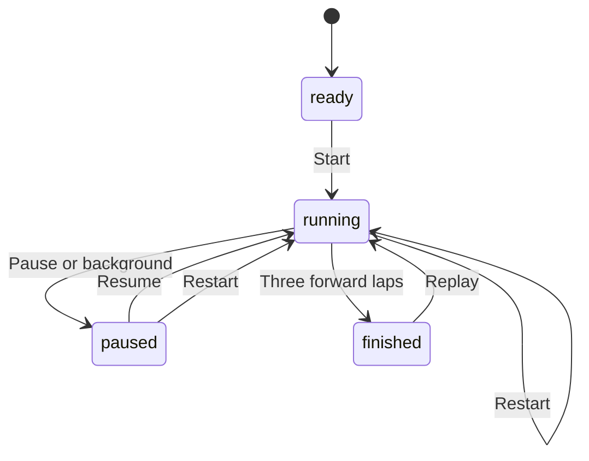

# Vehicle state machines and verification

`dist/game.js` and `dist/perspective.js` are the runtime source of truth. This
document maps the nine overlapping state groups to executable checks. Race and
camera modes are explicit enums; motion, surfaces and feedback are derived.

| Group | States and transitions | Formal model | Runtime evidence |
| --- | --- | --- | --- |
| Race | ready → running ⇄ paused → finished; restart resets a race; three forward laps finish; reverse does not add laps | Race | drive.cjs, state-contract.cjs, browser-states.cjs, browser_e2e.py |
| Input | 4 actions, 16 action combinations; independent keyboard/pointer sources; pause/fall/finish clear input | Input | All 256 subsets of 8 representative sources, each press/release (4,096 transitions); browser keyboard and CDP touches |
| Motion | stopped, accelerating, coasting, braking, reversing, forward/reverse steering | Hazards abstracts speed sign only | Physics tests and all-camera screenshots; acceleration with real animation |
| Surface | road, curb, runoff, outer edge, fall; return to safety | Hazards abstracts zone crossings | Exact 87/106/160/210 distance boundaries and screenshots |
| Collision | separation, bounce, impact feedback, cooldown, feedback clears | Hazards abstracts sign reversal and cooldown | Forward/reverse/low-speed obstacle contacts and screenshots |
| Recovery | fall begins → advances → automatic recovery +5; manual recovery +3; pause freezes fall | Hazards safety and weak-fair progress | Penalty once, manual recovery cancels pending automatic recovery, paused fall |
| Camera | first / chase / top; change does not mutate race, pose or hazard | Race and Persistence | Three cameras × both orientations; 240 headings, building occlusion and falling camera |
| Feedback | fall takes priority over impact, then surface; road hides warning; pause/finish overlays | Hazard state only; priority/rendering verified in browser | Feedback DOM assertions, screenshots; pixel checks supplement visual review |
| Persistence | best is minimum finish time; slower scores preserve it; valid camera restores; invalid camera falls back | Persistence | Reload, better/slower results and localStorage checks |

## Formal scope and finite bounds

TLC explores every reachable state in each checked finite model, with no state
constraint pruning. `Race` uses three abstract sectors per lap, three laps and a
clock saturated at two; it checks lifecycle, reverse direction, inactive-clock
freeze and camera independence. It does not assert an unattended driver will
finish a race. Real track progress is checked separately in JavaScript.
An independent event marker identifies reverse steps; `BuggyReverse=TRUE` must
violate `ReverseCannotAddLap`.

`Input` uses eight representative sources covering all four actions, including
four concurrent throttle sources. The effective action set must equal the union
of held sources, and blocked input must be neutral. `BuggyRelease=TRUE` recreates
the alias-release regression and must violate `ActiveMatchesHeld`.

`Hazards` abstracts speed to stopped/forward/reverse, uses two stages for fall,
impact and cooldown, and allows up to two manual and two automatic recoveries
between resets. It checks exact accumulated penalties, fall/surface consistency,
pause freeze and cooldown suppression. Low contact abstracts separation without
impact feedback; geometric separation is a runtime assertion. Weak fairness of
Tick and AutoRecover guarantees a falling running car reaches recovery or pause.
This assumes simulation ticks continue; it does not require progress while paused.
`AutoPenalty=10` must produce an `ExactRecoveryPenalty` counterexample.
An independent contact event marker checks cooldown behavior;
`BuggyCooldown=TRUE` must violate `CooldownSuppressesFeedback`.

`Persistence` explores scores 1..3 plus no score, all camera modes, invalid saved
camera, repeated finishes and reloads. Best must equal the minimum submitted score.

These models are specifications, not a machine-checked refinement proof of the
JavaScript implementation. `tests/state-contract.cjs` executes the real runtime's
matching operations; existing physics and browser tests cover continuous values,
geometry and pixels. Keep model assumptions and code mappings current.

## Reproduce

Follow `.agents/skills/verify/SKILL.md`, then run `.venv/bin/python tests/verify.py`.
For formal checks alone run `python3 tests/verify_tla.py`. Results and all TLC
counterexamples are written to `verification/latest/tla/`. `verification/latest/`
is regenerated per run and ignored by Git; retain the reviewed run's evidence
with its revision in `verification/` or the CI artifact before reporting PASS.

Official setup references: [TLA+ tools](https://github.com/tlaplus/tlaplus/blob/master/USE.md),
[pinned TLA+ release](https://github.com/tlaplus/tlaplus/releases/tag/v1.7.4),
[Python Playwright browser installation](https://playwright.dev/python/docs/browsers).

## Map 02 Mountain Road

`dist/maps.js` defines the same centreline, height and width thresholds used by the road mesh, terrain, nearest-road projection, driving slope, cliff checks, recovery and minimap. Map 01 remains a three-lap circuit. Map 02 is an open route with five earned checkpoints and a summit finish.

`Mountain.tla` abstracts the mountain route to six sectors and five checkpoints. It checks that the summit cannot finish before all checkpoints, reverse preserves earned checkpoints, automatic/manual recoveries return to the earned checkpoint with +5/+3 penalties, and a paused route freezes. The finite model allows two recoveries between resets. `BuggyFinish=TRUE` must violate `SummitRequiresCheckpoints`. Map selection abstracts a new ready race; per-map best scores are checked by the actual runtime tests.

Mountain geometry uses road/curb/edge/fall thresholds 57/65/77/96 world units (10 units = 1 metre). A continuous mountain-side wall constrains the negative side; the positive cliff side can fall. Physical grades, centreline distance, continuous driving and rendering remain runtime obligations, not TLA claims.

`tests/mountain.cjs` covers these transitions, distinct best storage and a continuous physics-only summit drive. `tests/browser-mountain.cjs` captures 42 scenarios across three cameras and two orientations, checks all 240 chase positions and real keyboard/touch input, then checks Canvas fallback. `tests/browser_e2e.py` uses normal animation for every map. The full command retains the original mountain and circuit matrices alongside the added course matrix, six models and seven named counterexamples.

## Shared map and course states

`dist/maps.js` owns the original circuit and Mountain Road. `dist/course-pack.js`
defines Proving Ground, City Blocks and Wild Trail; its sampled centerline, widths,
material IDs, checkpoints, routes and world objects drive both rendering and physics.
`dist/course-world.js` owns ordered checkpoint state, traffic, tokens and jumping.

| State group | Contract | Evidence |
| --- | --- | --- |
| Course lifecycle | Switching maps clears the run, input, jump and collected set; each map has its own best key | Courses.tla, courses.cjs, browser-courses.cjs |
| Ordered checkpoints | Five checkpoints each lap, three forward laps; reverse/teleport cannot finish | Courses abstracts two checkpoints per lap; courses.cjs drives all actual checkpoints and continuous physics |
| Traffic | Main-road green/amber/red; AI cross traffic waits; player red/amber crossing adds 3 seconds once; paused simulation freezes vehicles | Courses cross-line abstraction; runtime contracts and browser screenshots |
| Offroad jump | grounded → rising → falling → landed; pause freezes, recovery and map switch clear flight | Courses air states; runtime and browser jump cases |
| Exploration | Set membership makes collecting a marker idempotent; marked shortcut is drivable with grass friction | Courses token set, courses.cjs |

`Courses` explores three maps, three laps, two abstract checkpoints per lap,
three air stages, two tokens, two signal states and one crossing per model run.
`BuggyCheckpoint=TRUE` must violate `EveryLapRequiresCheckpoints` on the first
illegal lap; `BuggyFinish=TRUE` must violate `FinishedHasCheckpoints`. This finite model
does not prove vehicle geometry, continuous gravity, AI avoidance or pixel correctness.
All five map implementations retain the separate real-browser checks.

The shared course finish is a forward start-line crossing within road width after
all five ordered checkpoints. Temporary offroad detours do not invalidate an
otherwise complete lap. Progress telemetry is not a second finish requirement.
Visible cross streets and shortcuts provide their own material and physical height;
route eligibility is separate from road-surface feedback. Proving Ground bank
offsets affect road vertices and the sampled vehicle ground height.

`tests/browser-effects.cjs` compares the actual rendered vehicle region against
a second render with only the player mesh removed: 240 headings and three fall
stages in each orientation. It also records six normal-animation collision/fall/
recovery videos and twelve hazard screenshots. Single-pixel checks remain
supplementary regressions. Canvas fallback checks include visible city stop-line
regions and independent visual review of climbing-road screenshots.

The non-WebGL perspective fallback uses a bounded-resolution software depth buffer
(up to 420×320) over the same clipped faces. Reciprocal depth resolves terrain, road,
markings, obstacles and the player independently of submission order. The explicit
overlapping-triangle browser case supplements the climbing-road screenshots.

City stop-line rendering in both projections and crossing penalties share one
pose, width and thickness. A penalty requires the vehicle centre to move forward
from the negative to positive side of that exact plane, within its lateral extent;
staying past it does not charge every frame. Runtime checks place the car one
world unit before the plane, cross it and test an out-of-width crossing.

The animation loop starts once at `DOMContentLoaded`, after the ordinary script
dependencies have initialized. A delayed perspective script must not cause a first-frame
`drawMinimap` error and permanently stop the loop. The real-browser startup regression
holds that script until two native animation frames have elapsed, then releases it and
requires normal keyboard acceleration on Proving Ground, City Blocks and Wild Trail.
