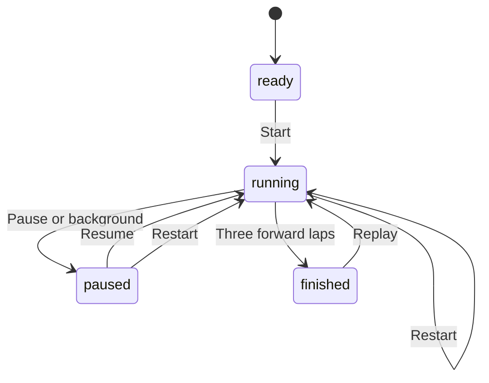

# Vehicle state machines and verification

The runtime source is `dist/game.js`, `dist/course-world.js`, `dist/course-pack.js`,
`dist/maps.js`, `dist/racers.js` and `dist/perspective.js`. The inventory below
lists 28 overlapping groups of stored, derived and temporal state. The computer
teams extension adds its actor, policy, contact and standings state in the later
section. This is a code inventory, not a claim that every possible emergent
behavior has a finite proof.

| # | State group and actual transitions | Source location | Finite model and runtime evidence |
| --- | --- | --- | --- |
| 1 | Race: ready → running ⇄ paused → finished; restart/replay resets run | `game.js:start/pause/reset/finish` | Race/Input; state-contract.cjs, browser-states.cjs, browser_e2e.py |
| 2 | Circuit progress: forward/reverse signed progress; three earned laps finish | `game.js:update` | Race abstracts sectors; drive.cjs checks actual progress |
| 3 | Mountain: five earned checkpoints → summit; reverse retains checkpoints | `game.js:update/recover` | Mountain; mountain.cjs, browser-mountain.cjs |
| 4 | Course checkpoints: five ordered CP each lap; legal forward start crossing completes lap | `course-world.js:updateCourseRace` | Courses abstracts two CP; courses.cjs drives actual checkpoints |
| 5 | Map lifecycle: five maps; switch → ready, clean run, per-map best, rebuilt geometry | `game.js:selectMap/reset`; `perspective.js:rebuildRoadMesh` | Courses/VehicleWorld; hidden-state-contract.cjs checks every map |
| 6 | Input sources: held keyboard/pointer set → union of four actions; pause/fall/finish clears | `game.js:setInputSource/clearInput` | Input; 4,096 implementation transitions and CDP multitouch |
| 7 | Pointer capture: down → captured → up/cancel/lost capture → released | `game.js` control event listeners | Input abstracts release; browser tests exercise source independence and cancellation |
| 8 | Focus: blur or hidden → paused and neutral; resume requires new input | `game.js` blur/visibility listeners | Input/VehicleWorld; browser-states.cjs, hidden-state-contract.cjs |
| 9 | Motion: stopped/accelerating/coasting/braking/reverse/forward again | `game.js:update` | Hazards/VehicleWorld abstract speed sign; actual physics and keyboard tests |
| 10 | Steering/slip: opposing steering cancels; steer/slip approach targets; recovery clears slip | `game.js:update`; `course-world.js:updateCoursePhysics` | VehicleWorld quantizes levels; actual grip, decay, cancellation and recovery contracts |
| 11 | Surface: road/curb/runoff/edge/fall; asphalt/grass/gravel/mud; main road/shortcut/cross street | `game.js:nearest/update`; `course-world.js:courseSurface/courseTerrain` | Hazards/VehicleWorld categories; actual thresholds, friction and geometry tests |
| 12 | Ground support/pose: nearest segment/interpolation → elevation/bank/grade; flight adds height; fall adds render drop | `game.js:nearest/edgeAt/update`; perspective draw functions | Rendering abstracts pose revision; continuous heights, chassis/camera continuity and occlusion remain browser obligations |
| 13 | Collision: separated/contact/penetrating → separation → rebound; props/wall/AI | `game.js:resolveCollisions/update`; `course-world.js:collideCourseObject` | Hazards abstracts sign reversal; drive.cjs, mountain.cjs, courses.cjs check geometry |
| 14 | Impact cooldown: eligible contact → impact/cooldown → decay → eligible; low-speed contact has no flash | `game.js:update/resolveCollisions`; `course-world.js:collideCourseObject` | Hazards; named cooldown mutation and browser effects tests |
| 15 | Fall: safe → begins → advances → automatic recovery; pause freezes fall | `game.js:update` | Hazards safety/progress; normal-animation fall/recovery recordings |
| 16 | Recovery: manual +3 / auto +5; return to road/earned CP; clear input/hazard/jump/slip | `game.js:recover` | Hazards/Mountain/Courses/VehicleWorld; penalty-once, raw state and synchronous HUD tests |
| 17 | Flight: grounded → rising → falling → landed; pause freezes; recovery clears height/velocity | `course-world.js:updateCoursePhysics` | Courses/VehicleWorld; actual launch eligibility and natural landing |
| 18 | Ramp latch: null → ramp ID → outside all ramp zones while grounded → null; prevents same-ramp relaunch | `course-world.js:updateCoursePhysics/resetCourseWorld`; `game.js:recover` | VehicleWorld; actual recovery retains latch, next outside-zone tick releases it |
| 19 | Collection: uncollected → Set member; repeated collection is idempotent; recovery preserves; new run clears | `course-world.js:updateCoursePhysics/courseDynamicMesh` | Courses/VehicleWorld abstract two tokens; runtime checks all six |
| 20 | Signals: green → amber → red → green; elapsed/period/offset; +3 penalty also shifts signal clock | `course-world.js:courseSignal/updateCourseRace` | VehicleWorld includes amber and clock shift; actual boundaries/offsets/period tests |
| 21 | AI traffic: outbound/inbound ping-pong; approach → wait on green/amber, go on red; pause freezes | `course-world.js:sampleTraffic/updateCourseTraffic` | VehicleWorld approach/direction/stop; actual endpoint continuity and signal tests |
| 22 | Stop line: in-width negative → positive charges once; staying after does not; reverse crossing rearms | `course-world.js:updateCourseRace` | VehicleWorld includes two crossings/re-arm; runtime checks plane, width, direction and repeated crossings |
| 23 | Camera: first/chase/top; overview/follow; clear/blocked/retracted boom; terrain support anchor excludes flight height; spatially averaged slope pitch/fall drop | `perspective.js:selectView/perspectivePose/chaseCameraFraction`; top-view functions | Race/Persistence/Rendering cover mode independence; CameraFeedback covers abstract output isolation; geometry and legal occlusion require continuous browser evidence |
| 24 | Feedback/effects: fall > impact > surface; dust rise/decay; body-only impact and roughness; toast replace → wall-clock expiry; capped skids | `game.js:updateFeedback/drawHazardEffects/draw/toast/update/vehicleBodyPose` | VehicleWorld priority/coarse dust/timer ownership; DOM/timer contracts plus full-draw world/body comparisons |
| 25 | Persistence: per-map minimum best; remembered map/view; invalid view fallback; storage failure | `game.js:finish/selectMap`, initial reads; `perspective.js` saved-view read | Persistence finite valid scores/invalid view; reload/per-map runtime tests; arbitrary corrupt numbers remain outside model |
| 26 | Bootstrap/frame: scripts initialize → DOMContentLoaded → one rAF chain; delta clamp → substeps → draw | `index.html` script order; `game.js:frame`, DOMContentLoaded listener | Rendering boot gate; delayed-script startup and normal-animation regression |
| 27 | Renderer: cold → WebGL/software; context valid/lost/restored; mesh upload; viewport/backbuffer; software depth allocation; draw/composite | `perspective.js:createMountainRenderer/drawMountainPerspective/drawSoftwareDepth/rebuildRoadMesh`; `game.js:resize` | Rendering lifecycle/frame consistency; actual loss/restore, resize, map switch and vehicle-region browser checks |
| 28 | Derived body pose: impact/road roughness, throttle/brake, steer and flight velocity → heave/pitch/roll; both 3D backends share one player mesh; first-view cockpit transforms locally | `game.js:vehicleBodyPose`; `perspective.js:playerCarMesh/drawCockpit` | No new clock or stored state. CameraFeedback output contracts, signed body checks and real visible-pixel changes in browser-body-camera.cjs |

`particles` is declared/reset but never advanced or drawn, so it is not an active
machine. Canvas transforms, CSS `perspective`/`pressed`, ARIA selection and overlays
present the groups above. Legal object occlusion, intended body motion and
an absent/stale rendered vehicle must be distinguished in pixel verification.

## Camera and body isolation

`vehicleBodyPose()` derives presentation from the existing simulation state. Its
impact envelope uses the existing impact decay; road pulses use simulation
elapsed time. Drawing does not advance either. Reset/recovery clear those
existing inputs, and pause freezes the simulation clock. This is a lightweight
visual response, not a wheel-by-wheel suspension or rigid-body physics solver.

The perspective camera follows road support elevation and the height difference
between samples 24 world units ahead and behind. This spatial averaging keeps
piecewise road grades from directly controlling pitch. It adds no temporal lag
state. Ramp flight height remains on the car. The fall offset and blocker-aware
camera boom remain. The body mesh projects the full ground gradient onto its
forward and lateral axes, including road banking when driving across a slope.

`CameraFeedback.tla` explores support levels -1..1, flight/feedback levels 0..2,
three views, redraw and recovery. Its three mutations must detect flight coupled
to the camera, feedback coupled to the world, and missing body feedback. This
checks a discrete output contract, not a JavaScript refinement or a proof of
continuous geometry, suspension, damping or landing physics.

`browser-body-camera.cjs` calls the actual `draw()` entry point. It compares the
world and minimap under three hazards on five maps and three views, with two
viewport orientations and both real rendering backends. Player geometry and
intentional color overlays are excluded only for this isolation measurement.
Separate complete draws must show visible vehicle feedback. The suite also
checks jump isolation, feedback direction and recovery. Existing normal-animation
driving, occlusion, flight/landing, fall/recovery and AI tests remain required.

The native flicker probe retains its 540 animation frames and all grounded
vehicle-region thresholds. An invisible falling car is accepted only when its
full body projection remains in view and every one of 50 vertex/face-centre
rays meets opaque terrain first. The probe then requires actual automatic
recovery and visible body pixels. Both renderers replay the captured deep-fall
pose. An open-road missing-mesh negative control must still fail. This
distinguishes legitimate terrain depth from absent or stale car rendering.

## Formal scope and finite bounds

TLC explores every reachable state in each checked finite model, with no state
constraint pruning. `Race` uses three abstract sectors per lap, three laps and a
clock saturated at two; it checks lifecycle, reverse direction, inactive-clock
freeze and camera independence. It does not assert an unattended driver will
finish a race. Real track progress is checked separately in JavaScript.
An independent event marker identifies reverse steps; `BuggyReverse=TRUE` must
violate `ReverseCannotAddLap`.

`Input` uses eight representative sources covering all four actions, including
four concurrent throttle sources. The effective action set must equal the union
of held sources, and blocked input must be neutral. `BuggyRelease=TRUE` recreates
the alias-release regression and must violate `ActiveMatchesHeld`.

`Hazards` abstracts speed to stopped/forward/reverse, uses two stages for fall,
impact and cooldown, and allows up to two manual and two automatic recoveries
between resets. It checks exact accumulated penalties, fall/surface consistency,
pause freeze and cooldown suppression. Low contact abstracts separation without
impact feedback; geometric separation is a runtime assertion. Weak fairness of
Tick and AutoRecover guarantees a falling running car reaches recovery or pause.
This assumes simulation ticks continue; it does not require progress while paused.
`AutoPenalty=10` must produce an `ExactRecoveryPenalty` counterexample.
An independent contact event marker checks cooldown behavior;
`BuggyCooldown=TRUE` must violate `CooldownSuppressesFeedback`.

`Persistence` explores scores 1..3 plus no score, all camera modes, invalid saved
camera, repeated finishes and reloads. Best must equal the minimum submitted score.

These models are specifications, not a machine-checked refinement proof of the
JavaScript implementation. `tests/state-contract.cjs` and
`tests/hidden-state-contract.cjs` execute matching operations in the real runtime;
physics and browser tests cover continuous values, geometry and pixels. Keep
model assumptions and code mappings current.

## Hidden gameplay model and implementation contracts

`VehicleWorld.tla` checks five independent partitions in one finite graph:
motion, jump/ramp latch, traffic/crossing, collection and feedback/timers. Each
initial state chooses one partition and keeps that choice. This checks each
partition with lifecycle, input gating, focus loss, recovery and pause. It does
not explore their full cross-product. Race/checkpoint/recovery penalties retain
their dedicated models. Browser and actual-runtime tests exercise combined
states across these partitions.

| Partition | Finite representation | Actual-runtime obligation |
| --- | --- | --- |
| Motion | Three speed signs, three steering directions, four materials, three slip levels | Acceleration, slope, grip, limits, smoothing and slip direction; a falling coarse slip level represents decay, not an exact float reaching zero |
| Jump/ramp | Ground/rise/fall, two ramp IDs, outside-zone re-arm event | Launch radius, forward speed/alignment, gravity, landing and collision height; recover retains latch, next grounded outside-zone tick clears it |
| Traffic/crossing | One 12-second signal: 6 green/1 amber/5 red; AI approach/direction/stop; at most two forward crossings and reverse re-arm | Per-junction offsets, movement/route geometry, line width/direction and approach bounds; charging shifts the model signal clock by 3 seconds |
| Collection | Two Set members | Six actual markers, distance/radius and geometry; recovery retains membership, map/restart clears it |
| Feedback/timers | Coarse impact/fall/dust, priority, at most two toast generations and pending timer IDs | Real thresholds, rendering, raw dust frozen during fall, vibration and timeout timing; cleared timers cannot hide a replacement toast |

The pause property freezes simulation fields, not wall-clock timers. A toast can
expire while paused. Top-view camera smoothing can continue during drawing.
Neither behavior is simulated physics progress. `gameSnapshot()` excludes
camera, renderer, frame and timer state, so an equal snapshot alone cannot
establish identical pixels or absence of flicker.

| Mutation constant changed to TRUE | Required counterexample |
| --- | --- |
| `BuggyRecovery` | `RecoveryClearsFlightAndSlip` |
| `BuggyCrossing` | `CrossingRequiresNegativeSide` |
| `BuggyFeedback` | `FallDominatesImpact` |
| `BuggyToast` | `NewToastOwnsTimeout` |
| `BuggyCollection` | `CollectionNeverShrinks` |

`tests/hidden-state-contract.cjs` checks 26 actual-runtime contracts, including
every map's pause/reset, ramp launch/re-arm, all material grips, amber boundaries,
AI endpoint continuity, forward/reverse/repeated stop-line crossings, six tokens,
priority, dust and replacement-toast ownership. Its DOM and wall clock are
deterministic stubs. It asserts no rendered pixels; browser tests remain necessary.

Remaining numeric-storage boundary: `Number(savedBest) || null` accepts negative
and infinite corrupt best scores. The valid-score Persistence model does not
prove arbitrary localStorage values are sanitized. This inventory records that
boundary rather than claiming an input-validation rule the implementation lacks.

## Reproduce

Follow `.agents/skills/verify/SKILL.md`, then run `.venv/bin/python tests/verify.py`.
For formal checks alone run `python3 tests/verify_tla.py`. Results and all TLC
counterexamples are written to `verification/latest/tla/`. `verification/latest/`
is regenerated per run and ignored by Git; retain the reviewed run's evidence
with its revision in `verification/` or the CI artifact before reporting PASS.

Official setup references: [TLA+ tools](https://github.com/tlaplus/tlaplus/blob/master/USE.md),
[pinned TLA+ release](https://github.com/tlaplus/tlaplus/releases/tag/v1.7.4),
[Python Playwright browser installation](https://playwright.dev/python/docs/browsers).

## Map 02 Mountain Road

`dist/maps.js` defines the same centreline, height and width thresholds used by the road mesh, terrain, nearest-road projection, driving slope, cliff checks, recovery and minimap. Map 01 remains a three-lap circuit. Map 02 is an open route with five earned checkpoints and a summit finish.

`Mountain.tla` abstracts the mountain route to six sectors and five checkpoints. It checks that the summit cannot finish before all checkpoints, reverse preserves earned checkpoints, automatic/manual recoveries return to the earned checkpoint with +5/+3 penalties, and a paused route freezes. The finite model allows two recoveries between resets. `BuggyFinish=TRUE` must violate `SummitRequiresCheckpoints`. Map selection abstracts a new ready race; per-map best scores are checked by the actual runtime tests.

Mountain geometry uses road/curb/edge/fall thresholds 57/65/77/96 world units (10 units = 1 metre). A continuous mountain-side wall constrains the negative side; the positive cliff side can fall. Physical grades, centreline distance, continuous driving and rendering remain runtime obligations, not TLA claims.

`tests/mountain.cjs` covers these transitions, distinct best storage and a continuous physics-only summit drive. `tests/browser-mountain.cjs` captures 42 scenarios across three cameras and two orientations, checks all 240 chase positions and real keyboard/touch input, then checks Canvas fallback. `tests/browser_e2e.py` uses normal animation for every map. The full command retains the original mountain and circuit matrices alongside the course matrix, original six models and seven named counterexamples, and added hidden-state models with their named mutations.

## Shared map and course states

`dist/maps.js` owns the original circuit and Mountain Road. `dist/course-pack.js`
defines Proving Ground, City Blocks and Wild Trail; its sampled centerline, widths,
material IDs, checkpoints, routes and world objects drive both rendering and physics.
`dist/course-world.js` owns ordered checkpoint state, traffic, tokens and jumping.

| State group | Contract | Evidence |
| --- | --- | --- |
| Course lifecycle | Switching maps clears the run, input, jump and collected set; each map has its own best key | Courses.tla, courses.cjs, browser-courses.cjs |
| Ordered checkpoints | Five checkpoints each lap, three forward laps; reverse/teleport cannot finish | Courses abstracts two checkpoints per lap; courses.cjs drives all actual checkpoints and continuous physics |
| Traffic | Main-road green/amber/red; AI cross traffic waits; player red/amber crossing adds 3 seconds once; paused simulation freezes vehicles | Courses cross-line abstraction; runtime contracts and browser screenshots |
| Offroad jump | grounded → rising → falling → landed; pause freezes, recovery and map switch clear flight | Courses air states; runtime and browser jump cases |
| Exploration | Set membership makes collecting a marker idempotent; marked shortcut is drivable with grass friction | Courses token set, courses.cjs |

`Courses` explores three maps, three laps, two abstract checkpoints per lap,
three air stages, two tokens, two signal states and one crossing per model run.
`BuggyCheckpoint=TRUE` must violate `EveryLapRequiresCheckpoints` on the first
illegal lap; `BuggyFinish=TRUE` must violate `FinishedHasCheckpoints`. This finite model
does not prove vehicle geometry, continuous gravity, AI avoidance or pixel correctness.
All five map implementations retain the separate real-browser checks.

The shared course finish is a forward start-line crossing within road width after
all five ordered checkpoints. Temporary offroad detours do not invalidate an
otherwise complete lap. Progress telemetry is not a second finish requirement.
Visible cross streets and shortcuts provide their own material and physical height;
route eligibility is separate from road-surface feedback. Proving Ground bank
offsets affect road vertices and the sampled vehicle ground height.

`tests/browser-effects.cjs` compares the actual rendered vehicle region against
a second render with only the player mesh removed: 240 headings and three fall
stages in each orientation. It also records six normal-animation collision/fall/
recovery videos and twelve hazard screenshots. Single-pixel checks remain
supplementary regressions. Canvas fallback checks include visible city stop-line
regions and independent visual review of climbing-road screenshots.

The non-WebGL perspective fallback uses a bounded-resolution software depth buffer
(up to 420×320) over the same clipped faces. Reciprocal depth resolves terrain, road,
markings, obstacles and the player independently of submission order. The explicit
overlapping-triangle browser case supplements the climbing-road screenshots.

City stop-line rendering in both projections and crossing penalties share one
pose, width and thickness. A penalty requires the vehicle centre to move forward
from the negative to positive side of that exact plane, within its lateral extent;
staying past it does not charge every frame. Runtime checks place the car one
world unit before the plane, cross it and test an out-of-width crossing.

The animation loop starts once at `DOMContentLoaded`, after the ordinary script
dependencies have initialized. A delayed perspective script must not cause a first-frame
`drawMinimap` error and permanently stop the loop. The real-browser startup regression
holds that script until two native animation frames have elapsed, then releases it and
requires normal keyboard acceleration on Proving Ground, City Blocks and Wild Trail.

## Rendering freshness and chase-camera obstruction

`Rendering.tla` adds a finite resource/presentation model. It explores loading
versus ready, one scheduled loop, cold/WebGL/software backend, valid/lost context,
invalid/rebuilt GPU resources, two map mesh revisions, two viewport revisions,
three cameras, two abstract poses and clear/eligible-boom/legal obstruction.
A presented frame must use initialized dependencies, current mesh/viewport and
one pose. Lost WebGL must yield to software; restoration must recreate GPU
resources. An eligible near-boom obstruction must retract the chase camera.
Legal occlusion is retained. This abstraction does not run shader code or prove
ray/triangle geometry, numerical continuity, rasterization, or all combined
VehicleWorld interactions.

`perspectivePose()` derives camera position from the current car, grade and static
mesh. On mountain/general chase views, `chaseCameraFraction()` pulls the camera
before nonground mesh intersections. Eight world units give clearance beyond the
four-unit near clip. A 16-unit geometric envelope eases triangle-edge approach;
there is no timer or mutable camera state. Minimum horizontal separation is 29
units (rear chassis extent 21 plus clearance 8). Obstructions closer than that,
terrain, moving traffic and original-circuit occlusion retain runtime boundaries.
First-person and original-circuit projection remain unchanged.

The actual defect reproduces 60 physics ticks after mountain start, holding gas,
with a 390×844 viewport: x=909.2434647, y=3293.9195013, z=10.3158784. The old fixed
150-unit boom lets the starting crossbar cover almost the entire car (88 car-only
pixels); removing only that beam diagnostically restores 2,515. Production keeps
the beam and retracts the camera. `browser-camera.cjs` preserves the exact sequence
and checks 75 ticks across three sizes and both actual renderers. It also checks
adjacent boom-distance changes on this measured route.

A separate official `WEBGL_lose_context` reproduction makes the old renderer
claim success while car-only scene changes produce zero difference. Readback
shows this can be a stale previous frame rather than a vanished car. The fix
checks context loss before/during GPU drawing and after compositing, presents software frames during
loss, and recreates programs/buffers/version cache after restoration on the same
canvas/context. `browser-flicker.cjs` checks event-race handling, mid-composite loss, repeated loss,
paused pixel stability, map/camera/resize during loss, and restored pixels within measured bounds
against a fresh renderer. It separately uses normal animation and real keyboard
input for 540 frames. Physical phone/GPU-driver coverage remains separate.

| Rendering mutation | Expected counterexample |
| --- | --- |
| `BuggyLoss` | `NoStaleFrame` |
| `BuggyRestore` | `NoStaleFrame` |
| `BuggyMesh` | `CurrentMeshPresented` |
| `BuggyBoot` | `DependenciesBeforeDrawing` |
| `BuggyCamera` | `NearCameraKeepsCar` |

## Computer racers and team standings

`dist/racers.js` owns three computer vehicles. `ally` is a blue teammate;
`rival-1` and `rival-2` are red opponents. The player completes the four-member
roster on the blue team. `game.js` owns the active racer world and feeds its
current player, map, traffic and obstacles into `DriveRacers.step()`.
The controller chooses a forward waypoint, throttle, steering and a safe lane.
Positions advance by velocity integration. Only explicit recovery replaces a
vehicle pose with an earned checkpoint pose. Recovery is visible as a separate
`recovering` state. It is not ordinary driving.

| State | Entry | Allowed update | Exit |
| --- | --- | --- | --- |
| `racing` | New run or completed recovery | Physical steering, acceleration, road progress and contacts | Earn all checkpoints and finish, or begin recovery |
| `recovering` | Off-route or stuck computer | Running simulation counts down one second | Return to the earned checkpoint without increasing race progress |
| `finished` | Legal final crossing or mountain summit | None | Restart or map change creates a new actor |

The world advances only while the player race is `running`. `ready`, `paused`
and `finished` freeze computer state, recovery countdowns and simulation time.
Computer `simulationTime` is independent of the player's penalty-adjusted
`elapsed`, so a three-second recovery penalty cannot teleport the other cars.
Each restart and map switch creates a fresh roster, clears contacts and finishes,
and resets computer simulation time. Finished vehicles leave the contact set.

Contacts separate vehicle bodies and change approaching velocities. A height
difference of 24 world units prevents a contact. A contact cooldown prevents repeated
impulses and contact counts while the bodies remain close. It does not permit
overlap. These geometric rules need implementation and browser tests; the TLA+
contact event only abstracts contact eligibility and cooldown.

The teammate chooses `yield` and slows or changes lane when the player approaches
from behind on the same route. Computers can pass a slow or stopped forward car
when an adjacent lane is clear, and brake when it is blocked. Road width, height, bend and traffic decisions
remain continuous controller obligations. The controller uses the existing city
signal clock to stop before non-green lights.

Standings keep captured finish order before comparing remaining route progress.
Tied progress uses fixed ID order `ally`, `player`, `rival-1`, `rival-2`.
Ranks award 4, 3, 2 and 1 points. Blue and red points always sum to 10.
The HUD shows current team points. The existing player finish rule freezes the
world and records the points at the player's finish. It does not pretend that
unfinished cars have completed the race or that provisional team points are a
final all-car result.

### Finite computer models

`Competitors.tla` explores each of the three computer roles as one selected
actor, with the fixed four-member roster, two maps, two run epochs, four player
race phases, seven coarse progress positions, two ordered checkpoints, a
two-tick recovery, one-bit contact cooldown and two counted contacts. Eligible
player approach from behind, a forward car and a blocked lane are abstract
boolean inputs. An ally can pass a stopped forward car when its lane is free;
the yield obligation concerns an approaching player from behind. The clock wraps
over three values.
Reverse movement retains earned checkpoints. Recovery returns race progress to
the smaller of current progress and the earned checkpoint, so contact followed
by reversal cannot award progress. The recovery liveness property uses weak
fairness of running ticks: a pending
recovery eventually ends or the player race stops. It does not promise progress
while indefinitely paused. The selected-actor partition does not enumerate the
full simultaneous continuous three-computer world.

`CompetitorsRace.tla` separately explores all four racers together. Each has
three coarse progress positions and two checkpoint obligations. The finite
model explores bypassed checkpoints, finish interleavings, resets and tied
progress. It checks unique ranks, stable unique finish order, legal finishes,
frozen finished racers and team score conservation. A player finish stops the
world, matching the runtime. The final-course abstraction does not replace the
implementation's three-lap and five-checkpoint tests on each actual map.

| Computer mutation | Required counterexample |
| --- | --- |
| `Competitors.BuggyPause` | `PausedCompetitorsFrozen` |
| `Competitors.BuggyRecovery` | `RecoveryCannotAdvanceProgress` |
| `Competitors.BuggyYield` | `AllyYieldsToPlayer` |
| `Competitors.BuggyContact` | `CooldownSuppressesContact` |
| `CompetitorsRace.BuggyFinish` | `FinishRequiresCheckpoints` |
| `CompetitorsRace.BuggyReset` | `ResetClearsResults` |
| `CompetitorsRace.BuggyRank` | `EveryRankUnique` |

`tests/verify_tla.py` retains the previous eight models and 17 named regression
counterexamples, then runs both computer models and all seven named computer
mutations. A successful run requires exhaustive checking without state
constraints and the specific expected property failure for each mutation.
Finite model success is not a JavaScript refinement proof, a floating-point
physics proof, a rendering proof or physical-phone performance evidence.

`tests/racers.cjs` executes the actual controller and game code. Its route
completion cases run all five actual maps and static obstacles through ordinary
fixed physics steps until all three computers finish. They place the player far
away and omit moving cross traffic to isolate route completion. A stationary
player or traffic blockade can make a safe controller wait; those cases do not
establish unconditional finishing in the full game. Separate full-game city and
offroad cases retain an idle player and the actual city traffic and require the
computers to finish within 400 simulated seconds, catching indefinite braking
when a safe passing lane exists. The other contracts cover
checkpoint bypass rejection, pause, reset, map changes, finish order,
score, independent time, yielding, passing, contacts and earned recovery.
Its DOM fixture does not establish pixels or real animation. The separate
`tests/browser-racers.cjs` suite supplies real Chromium animation, input, visual
and lifecycle evidence. Both are part of the full project verification entry.

## Presentation observer

`dist/art.js` owns procedural meshes and the Map 01 palette. `dist/presentation.js`
reads simulation facts and owns optional effects, local preferences, event cursors
and Web Audio. It does not write physics, race clocks, checkpoints, AI or camera.

| State | Transition | Verification |
| --- | --- | --- |
| Effects | full ⇄ low; low empties the particle pool | 100 exact gameplay snapshots across five maps agree in both modes |
| Particles | eligible real impact, skid or landing → emit → decay; maximum 48 | Fixture event checks and real keyboard race contact |
| Sound | off → user gesture → running AudioContext; pause, blur, hidden or off → mute | Real Web Audio analyser output, frequency and mute checks |
| Event cursor | one rising impact, earned checkpoint, landing or finish → one notification | Real race finish count and bounded-event fixtures |
| New run | reset → empty effects and event counts | Browser reset and map lifecycle checks |

`Presentation.tla` is a finite abstraction of effects quality, particles, sound,
race lifecycle and score isolation. It requires three deliberate failures to
violate score preservation, pause silence and the particle bound. It does not
prove JavaScript refinement, audio quality, geometry or physical-device timing.
`browser-presentation.cjs` executes the implementation and checks waveform output.
`browser-slice.cjs` drives normal keyboard events through native animation and
requires a natural 60–90 second three-lap race, real AI contact, a saved score and
frozen finish ranking. It never teleports the player or calls finish directly.

## Original concept art implementation

The original four generated concepts are archived in the project's [concept and
runtime Page](https://chatgpt.com/space/page_250e5db70e1c8191906045b0cd11e64d).
They are visual targets for fidelity review, not evidence of implemented gameplay.
Map 01 uses an actual red coupe mesh, circular wheel geometry, a dusk skyline,
a ring landmark, cyan gates and orange route guidance. Other maps keep their own
terrain. Player collision size, race clocks and four-car teams remain the same.
The cyan road chevrons indicate direction, not a boost pickup.

`perspectivePose()` uses a 105-unit, 48-unit-high chase rig on Map 01, with a
32-unit lateral offset and 0.15 radian look-ahead yaw. The offset and yaw ease
spatially to zero between the runoff and cliff boundary, keeping a falling
vehicle and its camera outside the platform wall. Other maps retain their
150-unit, 92-unit-high rig and obstruction solver. Both use road support instead
of jumping or collision feedback to place the camera. Map 01 now shares the real
WebGL depth renderer and the bounded software depth fallback with the other maps.
World labels avoid reserved HUD regions. Cyan gate pillars share their physical
obstacle footprint with the art mesh. The outside circuit floor now joins the
cliff at -300 units; the old -2-unit floor contradicted the fall region and
hid the car halfway down once depth testing was enabled.

Presentation owns a pool of at most 96 tire-mark faces. Skid state comes from
actual slip, braking or the circuit's existing steering skid condition. Trails
stay on sampled ground; recovery and new runs break continuity. Air time reads
the existing jump simulation. Pause freezes both timers. Quality changes clear
optional meshes and do not change physics, input, results or team points.
The finite `Presentation` model now abstracts trail capacity as three slots,
drifting and airborne flags. It adds a required trail-overflow counterexample.
Runtime tests enforce the actual 96-face capacity and check jump/landing, pause,
restart, four viewport layouts, all controls and both rendering paths.
