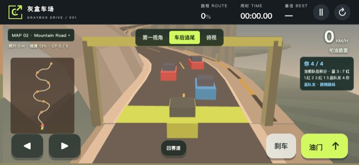
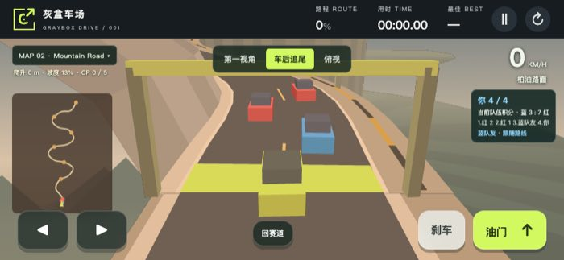
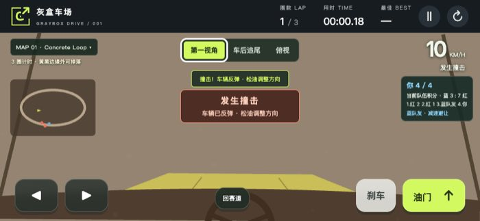

# Camera stability and vehicle feedback

The repair separates camera motion from vehicle feedback. The world and minimap
remain stable during impact and road vibration. The visible car carries the
heave, braking pitch and cornering roll. First view applies the same feedback
only to the cockpit. The perspective camera follows terrain support instead of
ramp flight height, retains cliff drop and near-obstacle retraction, and averages
road slope over a 48-unit span.

## Reproduction and targeted acceptance

Baseline runtime: `fd0fc12` (the same runtime assets as `5996d4c`). Real Chromium
134.0.6998.35 reproduced a 30-unit camera lift from 30 units of flight, and a
whole-frame translation of `[6.760506927952092, -3.640289430500885]` at impact
0.8 and simulation time 0.031.

The final `tests/browser-body-camera.cjs` was run against the baseline assets
before the fix. Its exact failure was:

```text
AssertionError [ERR_ASSERTION]: webgl-844/circuit/first/impact-world: feedback moved the world or minimap

29253 !== 0
```

The same test passes against the repaired assets in both real renderers and
both 844×390 and 390×844 viewports. It records 232 checks across the four
configurations, including 180 full-draw world/minimap comparisons, 40 visible
body comparisons and 12 jump/body/recovery checks. The largest world-image
change is zero pixels above the per-pixel RGB-sum threshold of 12. Every jump-camera delta is zero. The smallest visible
body-image change is 138 pixels. Color overlays and player geometry are removed
only for the isolated world comparison. Complete draws separately verify visible
feedback. Repeated Canvas readback is warmed before pixel comparison because
Chromium can switch its raster backend during readback.

```text
PASS webgl-844 full draw: five maps, three views, three hazards, stable world/minimap, independent jump and body
PASS webgl-390 full draw: five maps, three views, three hazards, stable world/minimap, independent jump and body
PASS software-844 full draw: five maps, three views, three hazards, stable world/minimap, independent jump and body
PASS software-390 full draw: five maps, three views, three hazards, stable world/minimap, independent jump and body
```

These real screenshots show the same mountain spawn and impact phase, before
and after the repair. They are JPEG copies of actual browser captures.





## Full release verification

The complete pre-commit `.venv/bin/python tests/verify.py` passed in the Mac
execution environment. It retained 536 screenshots and seven native-animation
recordings. All 54 runtime, model and verification source hashes match the
checkout being committed. The selected summaries and full hash list are in
[camera-evidence.json](camera-evidence.json).

| Check | Result |
| --- | --- |
| Syntax, race/physics, input and hidden-state contracts | PASS |
| Computer-driver implementation and browser contracts | PASS, 25 and 93 checks |
| Finite TLC models and required mutation counterexamples | PASS, 11 models and 27 counterexamples |
| Reachable states across the independent finite model graphs | 1,089,131, including 5,077 in CameraFeedback |
| Original camera/occlusion, cross-map and rendering regressions | PASS |
| Full-draw body/camera isolation | PASS, 232 records |
| Native Python Playwright animation and keyboard input | PASS, 30 checks |
| Linux CI, publication and complete public-site rerun | Pending |

This first-view screenshot comes from the actual native-animation collision
recording, with real keyboard input and the game's physical collision response.



## Scope

`CameraFeedback.tla` checks the finite output-isolation contract and three named
counterexamples. It does not prove JavaScript refinement, continuous vehicle
physics, suspension or damping. Existing full physics, input, five-map, camera
occlusion, WebGL restoration, native-animation, flight/landing, recovery and
computer-driver suites remain required. No new presentation clock or stored
state is introduced. The existing physics substeps remain unchanged.

The Work host's installed Playwright browser was actually attempted. Its pinned
browser crashed during navigation; system Chromium reported `socket() failed:
Operation not permitted`. Full browser execution uses the authorized Mac
environment and Linux CI. The Mac system Java launcher initially could not find
a runtime; the installed OpenJDK 21 binary is used for the complete rerun.
Android/iPhone physical devices and Safari/Firefox remain untested.
