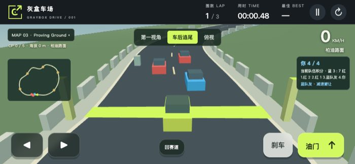
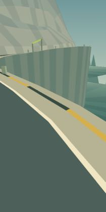
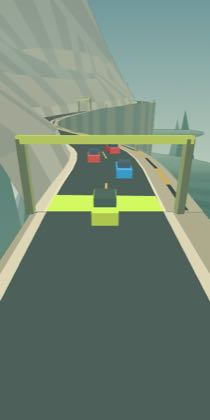

# Camera stability and vehicle feedback

The repair separates camera motion from vehicle feedback. The world and minimap
remain stable during impact and road vibration. The visible car carries the
heave, braking pitch and cornering roll. First view applies the same feedback
only to the cockpit. The perspective camera follows terrain support instead of
ramp flight height, retains cliff drop and near-obstacle retraction, and averages
road slope over a 48-unit span.

## Reproduction and targeted acceptance

Baseline runtime: `fd0fc12` (the same runtime assets as `5996d4c`). Real Chromium
134.0.6998.35 reproduced a 30-unit camera lift from 30 units of flight, and a
whole-frame translation of `[6.760506927952092, -3.640289430500885]` at impact
0.8 and simulation time 0.031.

The final `tests/browser-body-camera.cjs` was run against the baseline assets
before the fix. Its exact failure was:

```text
AssertionError [ERR_ASSERTION]: webgl-844/circuit/first/impact-world: feedback moved the world or minimap

29253 !== 0
```

The same test passes against the repaired assets in both real renderers and
both 844×390 and 390×844 viewports. It records 232 checks across the four
configurations, including 180 full-draw world/minimap comparisons, 40 visible
body comparisons and 12 jump/body/recovery checks. In the Mac targeted run, the largest world-image
change is zero pixels above the per-pixel RGB-sum threshold of 12. Every jump-camera delta is zero. The smallest visible
body-image change is 138 pixels. Color overlays and player geometry are removed
only for the isolated world comparison. Complete draws separately verify visible
feedback. Repeated Canvas readback is warmed before pixel comparison because
Chromium can switch its raster backend during readback.

```text
PASS webgl-844 full draw: five maps, three views, three hazards, stable world/minimap, independent jump and body
PASS webgl-390 full draw: five maps, three views, three hazards, stable world/minimap, independent jump and body
PASS software-844 full draw: five maps, three views, three hazards, stable world/minimap, independent jump and body
PASS software-390 full draw: five maps, three views, three hazards, stable world/minimap, independent jump and body
```

These real screenshots show the same mountain spawn and impact phase, before
and after the repair. They are JPEG copies of actual browser captures.


## Full release verification

The complete pre-commit `.venv/bin/python tests/verify.py` passed in the Mac
execution environment after the occlusion-probe correction. It retained 542 screenshots and seven native-animation
recordings. All 54 runtime, model and verification source hashes match the
checkout being committed. The selected summaries and full hash list are in
[camera-evidence.json](camera-evidence.json).

| Check | Result |
| --- | --- |
| Syntax, race/physics, input and hidden-state contracts | PASS |
| Computer-driver implementation and browser contracts | PASS, 25 and 93 checks |
| Finite TLC models and required mutation counterexamples | PASS, 11 models and 27 counterexamples |
| Reachable states across the independent finite model graphs | 1,089,131, including 5,077 in CameraFeedback |
| Original camera/occlusion, cross-map and rendering regressions | PASS |
| Full-draw body/camera isolation | PASS, 232 records |
| Deterministic deep-fall occlusion, automatic recovery and missing-mesh rejection | PASS, both real rendering backends |
| Native Python Playwright animation and keyboard input | PASS, 30 checks |
| Linux CI, publication and complete public-site rerun | [All three jobs PASS](https://github.com/LiuShiyuMath/graybox-drive/actions/runs/42793331323) |

The verified revision is `8d7e9cc45318749cd5e115397311a3067281c456`; its
runtime assets are unchanged from the camera repair `ba0e6bd`. Mac and Linux
pre-publication runs retain 542 screenshots each. The complete public-site run
retains 545 screenshots and seven recordings. It actually encounters five
terrain-occluded native frames and then verifies one visible automatic recovery.
Both deterministic backend fixtures and both missing-mesh negative controls pass.
All 54 tested source hashes match across the three full runs; all eight public
assets are compared with the checkout. Extra public captures document the
observed native occlusion and recovery rather than a different source version.

The screenshot below is from the verified public game with native animation.



This first-view screenshot comes from the actual native-animation collision
recording, with real keyboard input and the game's physical collision response.


## Scope

`CameraFeedback.tla` checks the finite output-isolation contract and three named
counterexamples. It does not prove JavaScript refinement, continuous vehicle
physics, suspension or damping. Existing full physics, input, five-map, camera
occlusion, WebGL restoration, native-animation, flight/landing, recovery and
computer-driver suites remain required. No new presentation clock or stored
state is introduced. The existing physics substeps remain unchanged.

The Work host's installed Playwright browser was actually attempted. Its pinned
browser crashed during navigation; system Chromium reported `socket() failed:
Operation not permitted`. Full browser execution uses the authorized Mac
environment and Linux CI. The Mac system Java launcher initially could not find
a runtime; the installed OpenJDK 21 binary is used for the complete rerun.
Android/iPhone physical devices and Safari/Firefox remain untested.

## First public-suite failure and replay

The first public run failed the existing native-animation flicker check at
`mountain/390/frame-31`. The fixed 36-frame probe had reached 4.2331 seconds;
the car was already 0.7742 seconds into a cliff fall. The test required a visible
car even when real road geometry blocked it. No runtime patch was made from
this failed hypothesis.

The exact pose was replayed in real Chromium against both the baseline and
repaired assets. Both produced zero player-body pixels. The car was 126.280
units from the road centre, beyond the 96-unit fall boundary. Its bottom was
at -11.220, below the real shoulder at 33.170–41.087. Independent geometry
inspection found that all 50 body vertices/face-centre rays met opaque roadMesh
terrain before reaching the car, with nearest blocking faces 76/88/89. Moving the new camera height back to the old
anchor also left zero pixels. This is legitimate depth occlusion in both
versions, rather than evidence for a new disappearing mesh.

The failed attempt is retained in
[workflow 42785696828](https://github.com/LiuShiyuMath/graybox-drive/actions/runs/42785696828).
Its failed public verification job is rerun with unchanged runtime source. The
native-animation probe now distinguishes geometrically verified fall occlusion
and requires visible recovery, while retaining every grounded-car assertion.
It does not skip falling frames based only on state. The exact
replay data is in [camera-occlusion-fixture.json](camera-occlusion-fixture.json).

Mac public-site Python Playwright checks passed separately with real keyboard
input, all five maps, all views, pause/reload, 40 screenshots and all eight
deployed asset SHA-256 values. The built-in cloud browser opened the game but
lost its tab during browser recovery; its extra click check is not counted as
a pass.

The deterministic replay passed both real rendering backends. All 50 rays are
blocked and the entire projected body remains inside the viewport. The original
full-vehicle threshold remains greater than 100 difference pixels. A missing
player mesh on open road is rejected even with a falling state. The following
pixel counts are from the Mac pre-commit replay; Linux counts are retained in
the machine-readable evidence.

| Renderer | Occluded difference pixels | Recovered difference pixels | Recovery penalty | Missing-mesh control |
| --- | ---: | ---: | ---: | --- |
| WebGL | 0 | 2,922 | 5 seconds once | Rejected |
| Software depth | 31 | 3,177 | 5 seconds once | Rejected |

The real canvas captures show the shoulder hiding the fallen car, followed by
the complete car after automatic checkpoint recovery.




