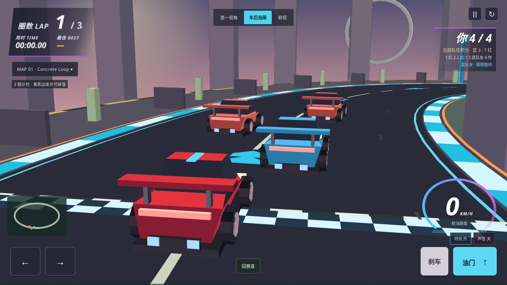
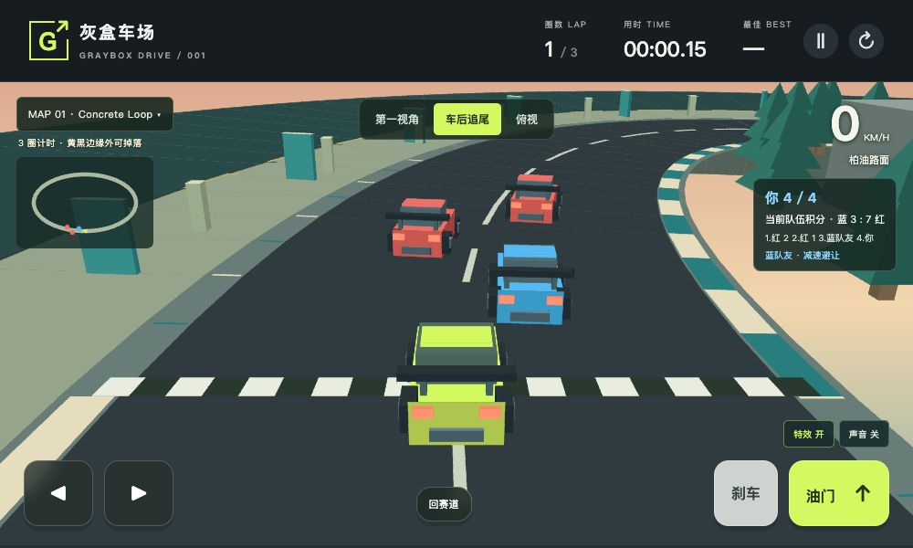
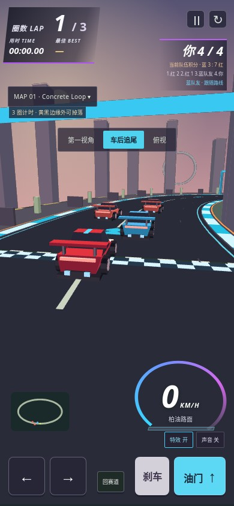
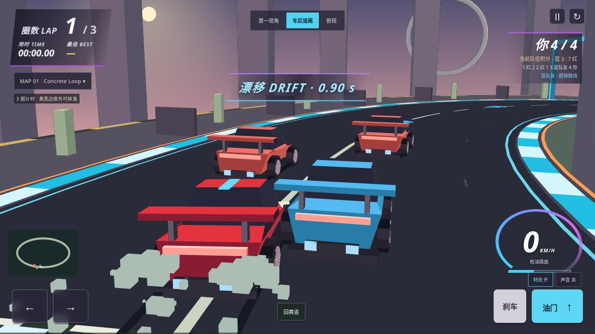
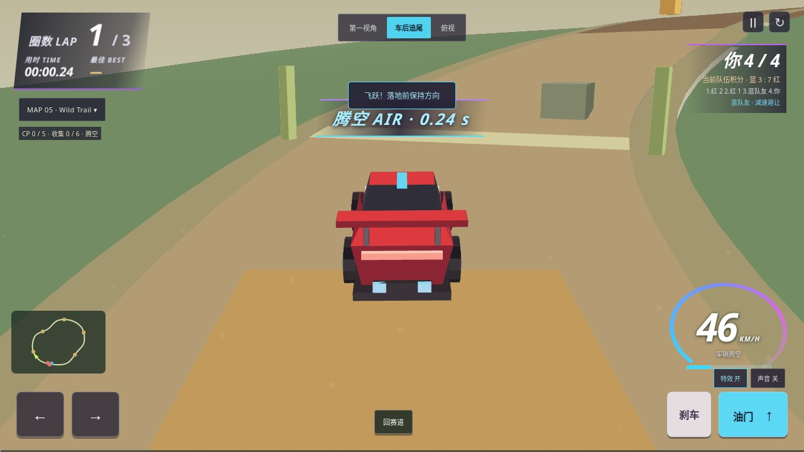
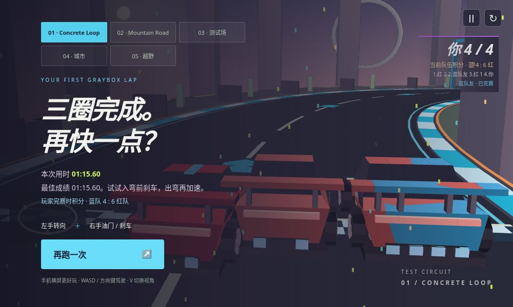
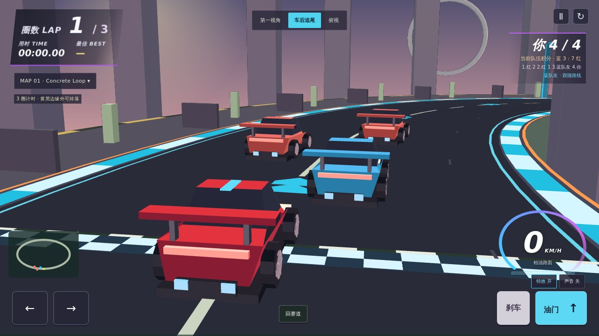
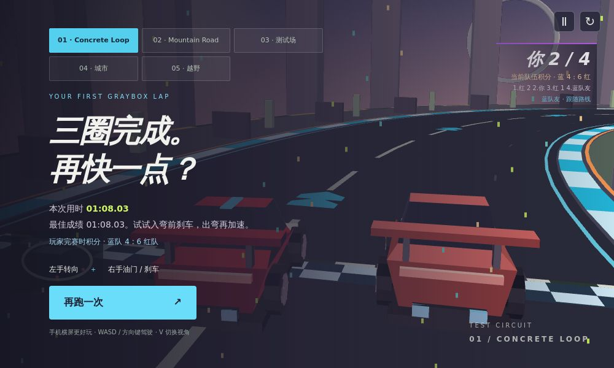

# Original racing concept implementation

The four original generated images were recovered and archived in the
[concept/runtime Page](https://chatgpt.com/space/page_250e5db70e1c8191906045b0cd11e64d).
No new conceptual image was generated.

## Executed acceptance

The frozen-source precommit command passed all 28 steps. It retained 562 screenshots
and eight recordings. All 64 runtime, model and verification source hashes match
the candidate. The base revision in `precommit.json` is the clean parent before
the candidate commit; the 64 hashes identify the tested changes.

The normal-animation keyboard race completed three earned laps in 75.60 seconds,
with 13 physical AI contacts, saved time, one finish celebration and frozen
standings. No teleport, direct finish call or clock override was used in that race.
The browser executed Chromium 134. Deterministic scene fixtures are separately
labelled and do not replace the natural race.

Twelve finite models and 31 deliberate counterexamples passed. The added trail
counterexample must violate `BoundedTrails`. Finite checking does not prove
continuous geometry, physical-phone performance or photorealistic fidelity.

## Scene review

The drift setup enters the existing skid condition. The air setup starts at the
existing Wild Trail ramp, then runs actual jump physics. The finish above comes
from the separate normal-animation keyboard race.

## Fixed differences and defects

- Red coupe, circular wheel geometry, dusk city, ring landmark, directional cyan
  road markings, orange bend signs, cyan gates and the race HUD replace the
  previous green test-circuit presentation.
- Map 01 has a lower rear-quarter chase view. Five maps and three cameras remain.
- WebGL and software depth correctly occlude the car. The outside floor was at
  -2 while the cliff extended below it; moving it to the cliff bottom prevents
  a phantom surface from hiding the falling car. Early/mid/late fall regions and
  building-occlusion negative controls pass.
- Moving the header into the scene initially blocked restart under the pause
  overlay. Header actions now remain reachable; keyboard, touch, pause and
  restart checks pass at every required viewport.
- Drift and air durations read actual simulation state. Optional tire marks are
  bounded at 96 faces and particles at 48. Low/full modes preserve 100 identical
  gameplay snapshots across all five maps.

## Publication

Runtime `de688eb` passes [all three release jobs](https://github.com/LiuShiyuMath/graybox-drive/actions/runs/42851855197). Each full run executes 28 commands and retains 562 screenshots and eight recordings. All 64 tested sources agree across precommit, Linux and the public site. All 12 deployed assets match. The public normal-keyboard three-lap race finishes in 68.03 seconds with 20 physical AI contacts. See [release receipt](release.json), [Linux evidence](ci.json), [public evidence](live.json) and [deployed hashes](deployed-assets.json).

Work-host public-browser attempts retained ERR_EMPTY_RESPONSE and, through its inherited proxy, ERR_CERT_AUTHORITY_INVALID. TLS verification was preserved. The full public suite ran successfully on Linux CI; neither local failure is claimed as PASS.

## Remaining concept differences

See [the fidelity table](../../docs/CONCEPT-FIDELITY.md). The executable art remains
stylized. Photorealistic materials/reflections, eight-car racing, 300+ km/h,
Boost rewards and a new suspended jump course remain open. Physical Android and
iPhone testing is separate from Chromium viewport simulation.

Normal-animation frame timing on this shared Work host was p50 66.6 ms and p95
133.3 ms. Functional acceptance is not a 60 FPS or phone-performance claim.
