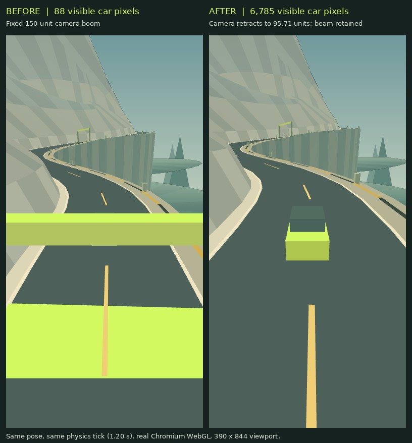

# Graybox Drive: flicker and hidden states

Date: 2026-11-10 (Asia/Taipei). Baseline: `b5900c057928f1a41bd9106495e4631b7f5978bb`.
The source audit identifies 27 overlapping explicit, derived and temporal state groups.
[Complete inventory and formal boundaries](../docs/STATE-MACHINES.md).

## Reproduced defects

### Mountain start beam hides the chase car

Start Mountain Road in chase view, hold gas for 60 actual 20ms physics ticks,
with a 390×844 viewport. The pose is x=909.2434647, y=3293.9195013,
z=10.3158784, elapsed=1.20s, nearest segment=3. There is no impact, fall or
offroad vibration. The fixed 150-unit camera boom crosses the start beam.
Car-only rendered difference drops to 88 pixels. Removing only that beam in a
diagnostic render restores 2,515 pixels at the identical pose.

The production fix retains all geometry and depth. A shared `perspectivePose()`
retracts the chase camera before static nonground mesh obstruction. The exact
failing frame now has 6,785 visible car pixels and a 95.7088-unit camera distance.
A geometric edge envelope controls entry/exit; no camera timer moves while paused.
Original-circuit projection and first-person behavior are unchanged.



[Original Canvas](flicker-baseline/beam-before.png) ·
[Fixed Canvas](flicker-baseline/beam-after.png) ·
[Baseline samples](flicker-baseline/beam-before.json) ·
[Fixed samples](flicker-baseline/beam-after.json).

The same committed `tests/browser-camera.cjs` fails on baseline source with:

```text
webgl-390/step-59: vehicle hidden by near-camera beam (88 pixels)
```

It passes all 450 frames after the fix: three sizes, two real rendering backends,
75 actual physics ticks per case. Beam geometry stays present. The test also
checks this route's adjacent camera-distance changes and chassis clearance.

### Lost WebGL presents stale content

The official `WEBGL_lose_context` extension sets `gl.isContextLost()` immediately,
before the queued event. The baseline still returns true from
`drawMountainPerspective()`, suppressing software fallback. Car-only scene changes
produce zero pixel difference instead of the normal 5,658 pixels at the fixture.
Raw Canvas readback shows this can be a stale previous frame, so zero difference
must not be reported as proof that the car itself vanished.

The fix checks loss before GPU work and before/after compositing, returns false to the
existing software depth renderer, handles the loss event to permit restoration,
and recreates shader/buffer/version resources on the same canvas/context.
Tests require immediate fallback before event delivery, loss during compositing, two loss/restore cycles,
paused pixel stability, camera/map/viewport changes during loss, and restored
pixels matching a fresh renderer of the new map and viewport. Cross-context
anti-aliasing/dithering permits RGB mean error below one level and fewer than
0.2% of pixels differing by more than 12 levels; an intentionally wrong map must
fail the same comparison. State, pose, and dimensions remain exact.

[Baseline readback](flicker-baseline/mountain-844-loss.json) ·
[Stale Canvas](flicker-baseline/context-stale-canvas.png).

## Verification

The exact candidate passed the full `.venv/bin/python tests/verify.py` on the
authorized Mac mini. All 44 tested source hashes match the cloud workspace.
[Machine-readable candidate evidence](flicker-precommit.json) retains 19 successful
commands and the dirty precommit base revision explicitly.

The release workflow runs the full command again on Linux before publishing, then
repeats it against GitHub Pages and compares every deployed asset. Publication
and live verification are separate gates; the project Page records their outcome.

Executed candidate coverage: eight finite TLC models, 17 named negative controls,
4,096 input transitions, 26 added implementation contracts, 471 screenshots,
486 existing car-region comparisons, 540 native-animation frames, 450 deterministic
beam frames and six collision/fall/recovery recordings.

The eight separate bounded models explore 84,174 distinct states in total.
[Normal-model logs and all named counterexamples](flicker-tla/) are retained.

The Work-host headless Chromium probe fails at navigation with `page.goto: Page crashed`.
Executable-browser acceptance uses the authorized Mac mini and GitHub Linux CI,
with source hashes compared to the candidate. Physical Android/iPhone devices,
Safari/Firefox, every GPU driver and continuous numeric correctness are not proved.

`VehicleWorld` checks five partitions independently, not their full cross-product.
TLC checks finite specifications, not a machine-checked JavaScript refinement.
The pre-existing arbitrary corrupt best-score storage boundary is documented in
the inventory; this rendering change does not modify score loading.
