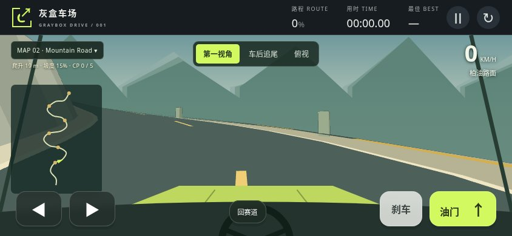
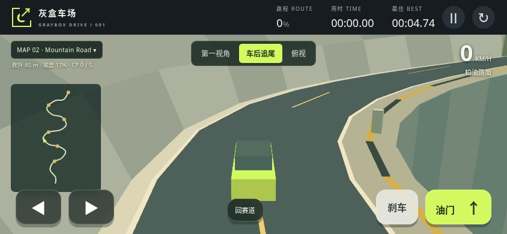
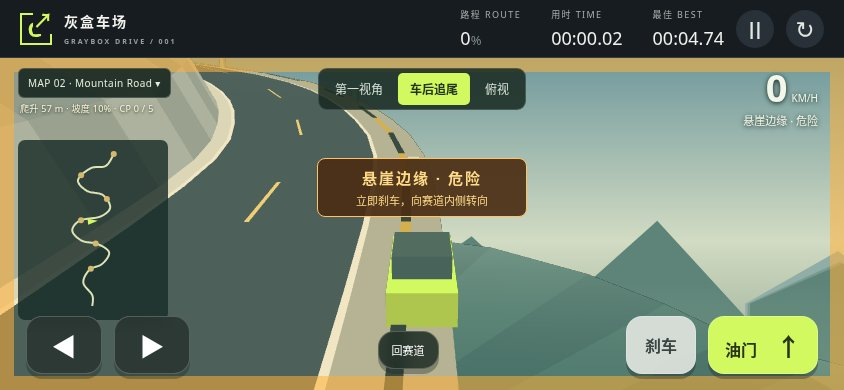
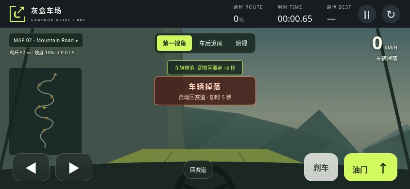
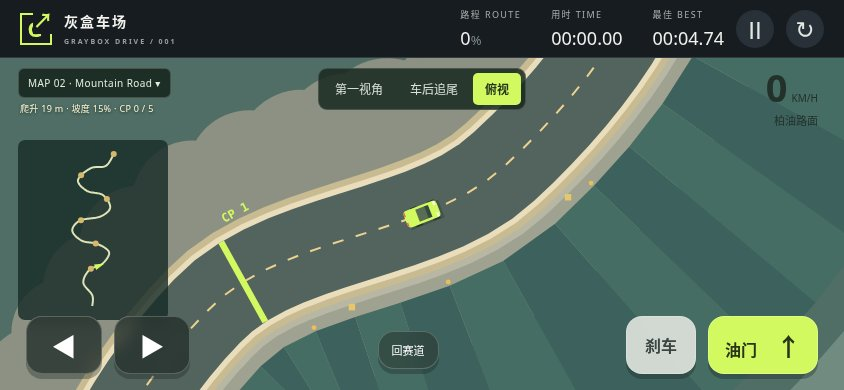
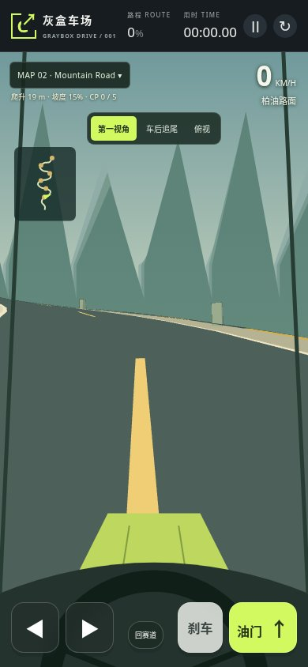

# Map 02 — Mountain Road 验收

2026-11-09。山脚到山顶，约 716 m，实际爬升 102 m。地图包括连续 S 弯、左侧山壁、右侧悬崖、可掉落路缘和 5 个顺序检查点。

[直接游玩](https://liushiyumath.github.io/graybox-drive/?map=mountain)

## 驾驶规则

- 通过检查点后到达山顶即完成，不计圈。进度显示为百分比。
- 坡度影响车辆加速，第一视角和车后视角跟随真实高度及坡度。
- 左侧山壁发生碰撞会分离并反弹。右侧黄黑边缘提示悬崖；越过边缘会掉落。
- 掉落后自动回到最近已通过的检查点，加时 5 秒。手动恢复加时 3 秒。
- 两张地图分别保存最佳成绩，切换地图会重置当前比赛。
- 保留第一视角、车后追尾、俯视和同时触屏转向与踩踏板。

## 真实 Chromium 验证

| 验证 | 结果 |
| --- | --- |
| 山路横屏 844 × 390 与竖屏 390 × 844，三种视角 | 42 个场景通过，截图见下方 |
| 山路场景与交互检查 | 51 项通过 |
| 全线车后视角后部车身的 Canvas 像素检查 | 240 / 240 通过 |
| 实际键盘油门 | 车辆前进且高度增加 |
| 双指转向与油门及独立松开 | 通过 |
| 地图切换、分别保存最佳成绩、重新加载 | 通过 |
| WebGL 不可用时的 Canvas 回退 | 通过，另留一张截图 |
| 原赛道回归 | 210 个场景和 30 项状态／像素检查通过 |

`node tests/mountain.cjs` 还执行从起点到终点的连续物理驾驶，未设置中途车辆位置：45.68 秒到达山顶，依次通过全部检查点，零碰撞，零掉落，最大偏离中心线约 2.02 m。此结果是自动驾驶测试，不是玩家成绩。

[山路机器可读结果](mountain/results.json)

## 第一视角



## 车后爬坡



## 悬崖警告与掉落





## 俯视与竖屏





## 验证范围

场景截图用测试夹具设置起点、比赛进度及车辆位置，再运行实际 update() 和浏览器渲染。键盘和 CDP 多指触控检查独立执行。连续物理驾驶测试另行验证全程可达。尚未进行 Android 或 iPhone 真机验收。

山路使用 WebGL 深度缓冲处理坡面遮挡。道路和路肩使用相邻网格，避免爬坡弯道上的重叠三角形缺口。车后摄像机的高度随坡度向后补偿，避免在陡坡上把车移出画面。

## 复现

```sh
node --check dist/maps.js
node --check dist/game.js
node --check dist/perspective.js
node tests/drive.cjs
node tests/mountain.cjs
node tests/browser-states.cjs
node tests/browser-mountain.cjs
```

浏览器脚本需要 Playwright 与 Chromium。自定义本地服务器时，可用 DRIVE_URL 与 DRIVE_MOUNTAIN_URL 指定两张地图地址；DRIVE_CHROMIUM_PATH 可指定浏览器。CI 执行两张地图的同一套验证。

山路已接入项目完整 `/verify`：五个有限 TLA+ 模型及五项指定故障反例，包括 Mountain 检查点/恢复/登顶模型；4,096 次实现输入转换；两张地图的 269 张 Chromium 截图与正常动画驾驶。形式化模型覆盖离散规则，不声称证明连续物理或渲染。

[完整验证及候选源码 SHA-256](mountain-full-verify.json)。完整验证在 Mac mini 通过，并逐一核对了与云端候选相同的 29 个源码哈希。云端 JavaScript 场景矩阵通过；云端 Python 正常动画浏览器曾崩溃，该环境不计完整 PASS。
