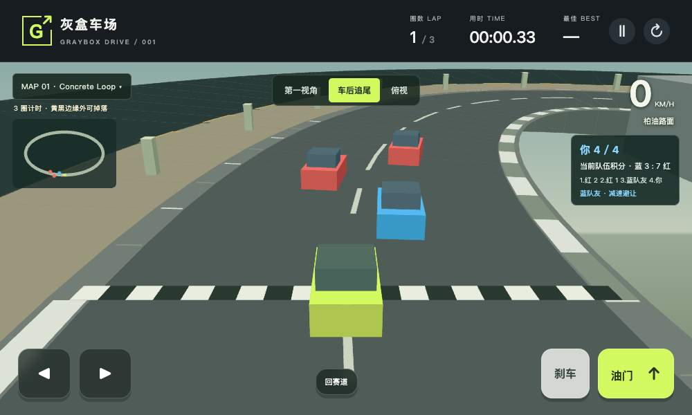
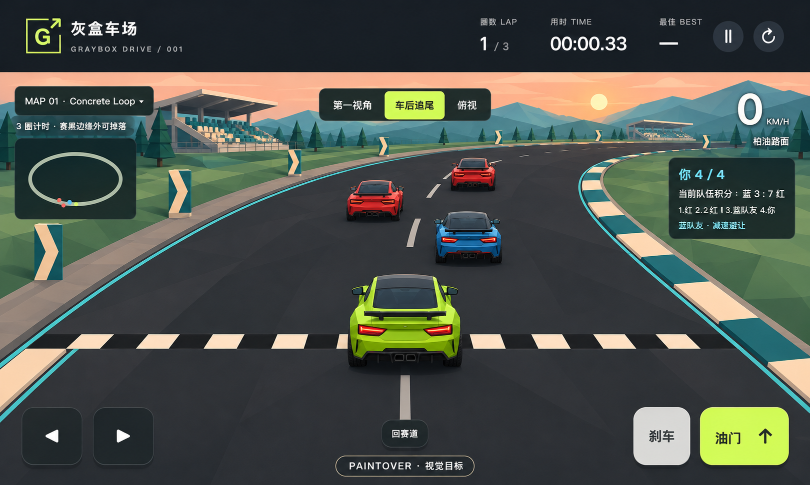
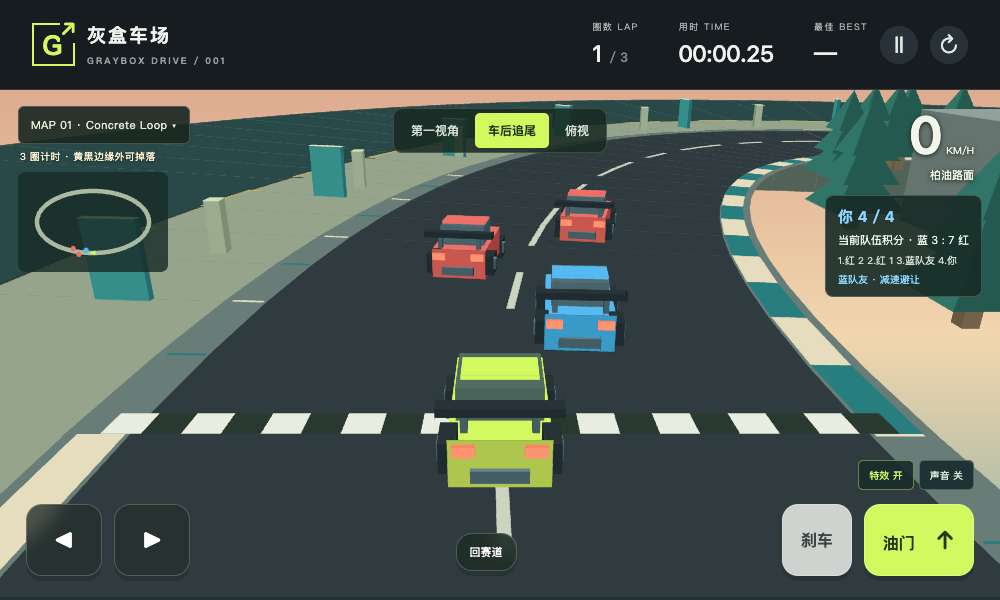
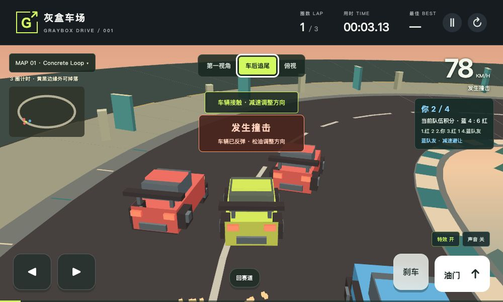
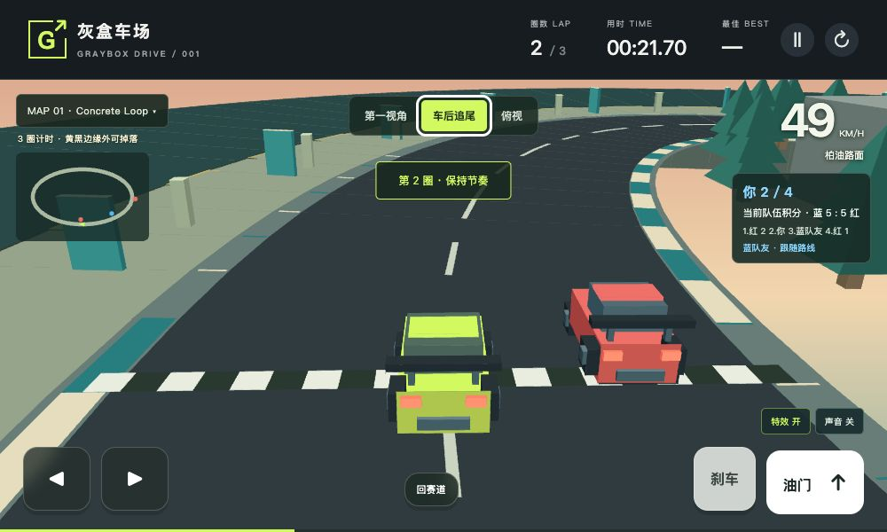
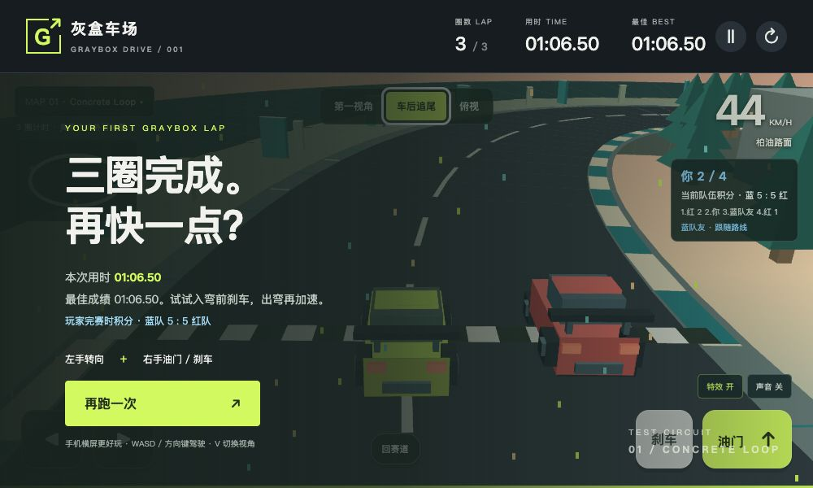
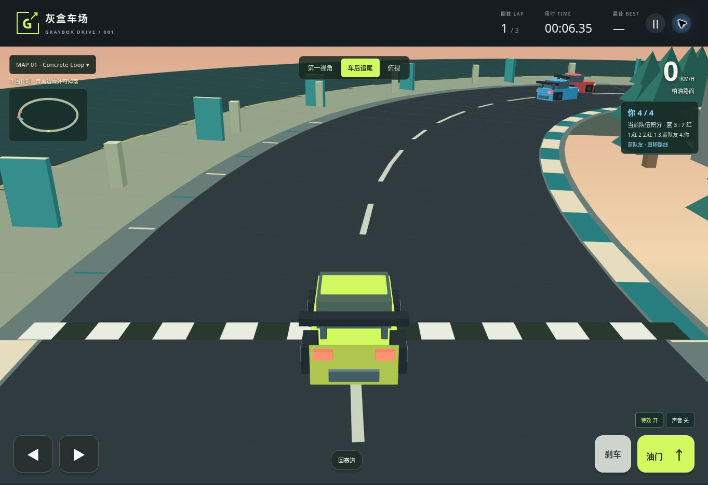
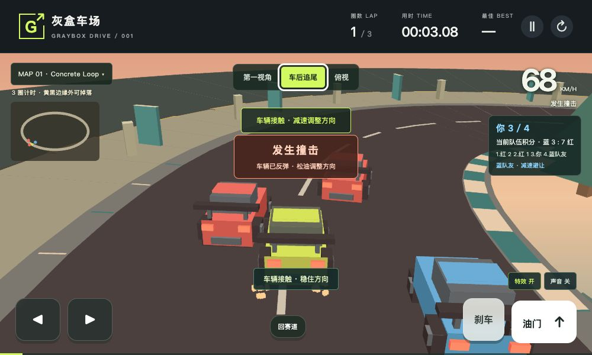
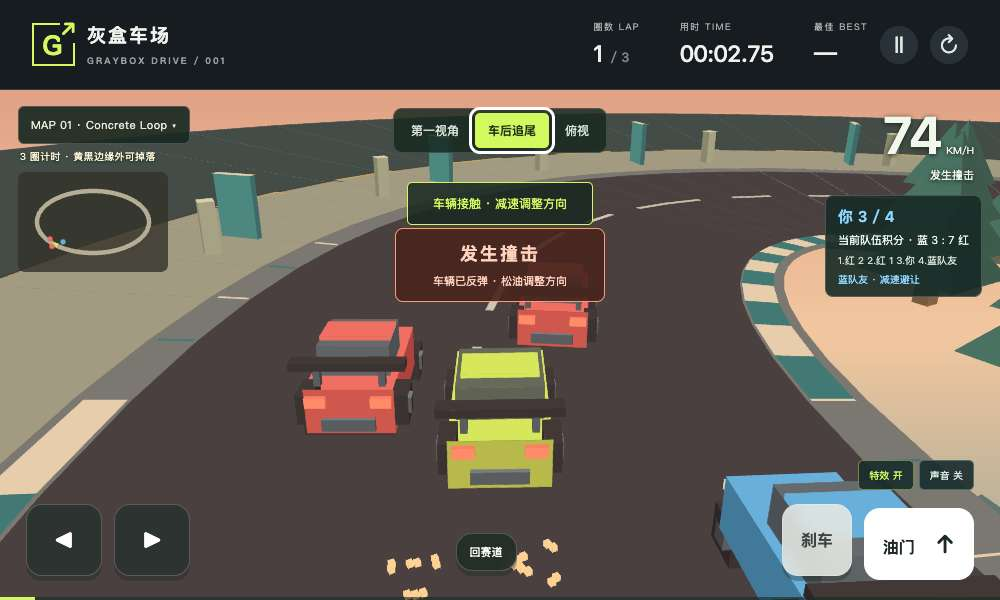

# Graybox Drive first art slice verification

The release keeps the original five-map gameplay baseline at `cdf296f` and adds
procedural art, localized feedback, optional synthesized sound and low effects.
Map 01 is the demonstration course. No race rules or camera pose calculations
were changed.

## Release gates

| Gate | Status | Evidence |
| --- | --- | --- |
| Frozen precommit source | PASS | 27 commands, 551 screenshots, 8 recordings, all 61 source hashes match |
| Linux verify | PASS | Runtime 41bd106, 27 commands, 551 screenshots, 8 recordings, all 61 hashes match precommit |
| GitHub Pages deploy | PASS | Exact runtime 41bd106, workflow 42831782524 |
| Deployed verify-live | PASS | Same full suite, 551 screenshots, 8 recordings, 61 hashes match; all 10 dist assets match |
| Real keyboard race | PASS | Polished frozen run: 66.50 s, three natural laps, two AI contacts, saved score and frozen ranking |
| Desktop performance profile | Measured; stable 60 FPS INCONCLUSIVE | Five alternating trials per side, `profile.json` |
| Public cloud browser | PASS | Actual throttle, chase view, AI movement, low effects, sound on/off, pause/resume and restart |
| Page media and readback | PASS | Both videos played to the end, all four flow images loaded; game and overview saved/read back |

[All release jobs](https://github.com/LiuShiyuMath/graybox-drive/actions/runs/42831782524)
passed for runtime `41bd106`. [Release summary](release.json), [Linux evidence](ci.json),
[public-site evidence](live.json) and [each deployed asset hash](deployed-assets.json)
retain the source and measurement details. The frozen precommit starts from
a84a657 with a dirty worktree; its complete 61-file manifest exactly matches
the later clean 41bd106 CI and live manifests.

The first complete run passed 27 commands and retained 551 screenshots and eight
videos. It is labelled diagnostic because its initial manifest predates the
final source freeze. It is not the release proof.

## Real image sequence

Original runtime, AI paintover target, candidate runtime and final race evidence
are separate files. The paintover is not a screenshot of running software.

[Frozen precommit evidence](precommit.json) · [Finite models and counterexamples](tla.json) · [Actual race evidence](race.json).

## Final real race flow

These four images and the two videos come from the HUD-polished `41bd106`
Mac run. Its three earned laps take 66.50 s. The full 82.16 s video includes
setup and gameplay; the 8 s version joins three excerpts. Neither uses mocked
animation or a forced finish. Both contain video only.

[Full 82-second recording](full-race.mp4) · [Edited 8-second preview](highlights-8s.mp4)
· [Media provenance, excerpt times and six file hashes](media.json).

### Start

### Physical AI contact

### Second lap

### Natural finish and saved score

The independent public-site run finishes in 66.58 s with two physical AI
contacts. It records 3,979 native frames with a 16.7 ms p95 interval; Linux
pre-deployment records 3,956 frames at the same p95. These are scoped desktop
observations, not a general 60 FPS guarantee.

## Preserved behavior

- Five maps, three cameras, 2v2 competitors and exact race/physics rules.
- Simultaneous steering and throttle, independent keyboard and pointer release.
- Mountain checkpoints, cliff recovery, city signals, offroad jumps and collection.
- Camera/body decoupling and actual terrain depth on WebGL and software.
- Best scores and view preference stay local to the player's browser.

## Added acceptance

`browser-presentation.cjs` compares 100 exact game snapshots in full and low
effects, verifies a real Web Audio waveform and silent paused/off output,
checks bounded particles and reset, preference persistence, reduced motion
and reachable controls at 844, 390 and 320 pixels.

`browser-slice.cjs` uses native animation and ordinary keyboard input to drive
all three laps. Route observations are read-only. No vehicle teleport, clock
override, direct finish call or forced score is used. It requires real AI contact,
impact and finish events, a saved best score and frozen finish ranking.

Visibility probes now hide the complete player mesh. New wheels and spoilers
cannot remain visible in the missing-car negative control. Existing grounding,
terrain occlusion, context restoration and camera thresholds remain in force.

`Presentation.tla` adds a finite presentation model and three required failures.
The complete suite has 12 finite models and 30 named counterexamples. These
models do not prove continuous geometry, audio quality or JavaScript refinement.

## Boundaries

The original Work-host pinned Chromium crashed on full navigation; that failure
is retained. Complete runtime testing uses the authorized Mac mini and Linux CI.
After the Work environment was restored, its shared cloud Chrome also passed
the public interaction check and played both Page videos to the end. Phone-size
emulation does not establish physical Android/iPhone or Safari/Firefox acceptance.

The desktop timing host had load near 12.8 on 10 cores. Baseline and candidate
both showed long frame-delivery delays. The five-trial data is descriptive;
stable 60 FPS and phone performance remain unverified. This release is a
stylized flat-shaded first art pass. Photorealistic final assets remain open.

Playwright recordings contain video only. Actual Web Audio output is verified
separately through the browser's analyser.

## HUD subtraction after media review

Real a84a657 collision media exposed a duplicate event-message layer over the
car. The final polish removes this added layer and keeps the existing toast,
hazard HUD, particles and sound. The supplementary ordinary-keyboard contact
probe captured the unobscured car after the change. The final source receives
its own complete precommit and deployment gates; the first candidate's success
is not reused as proof for the changed files.

