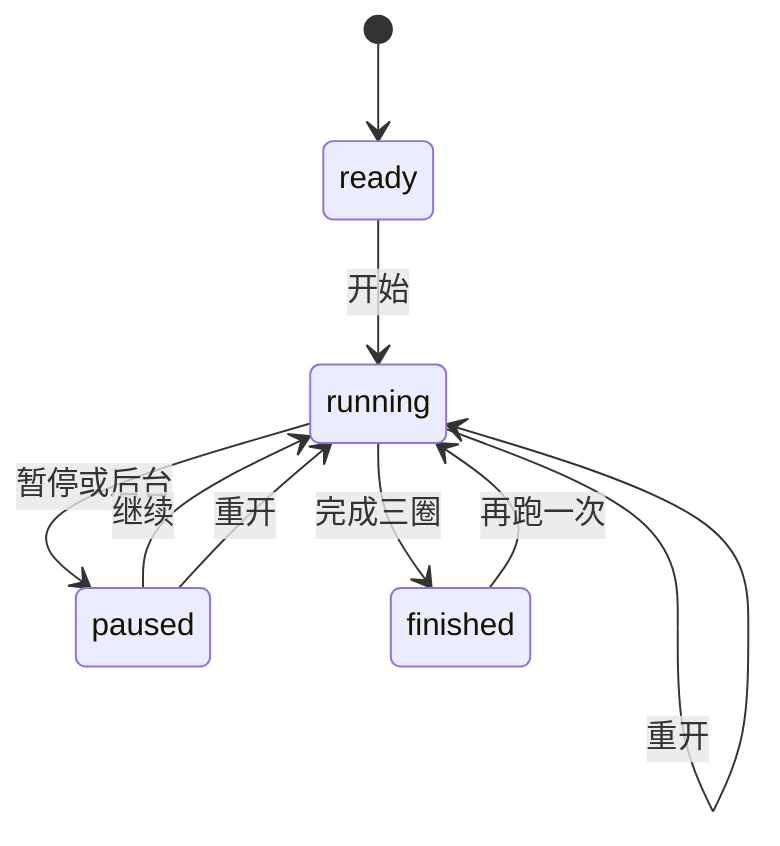
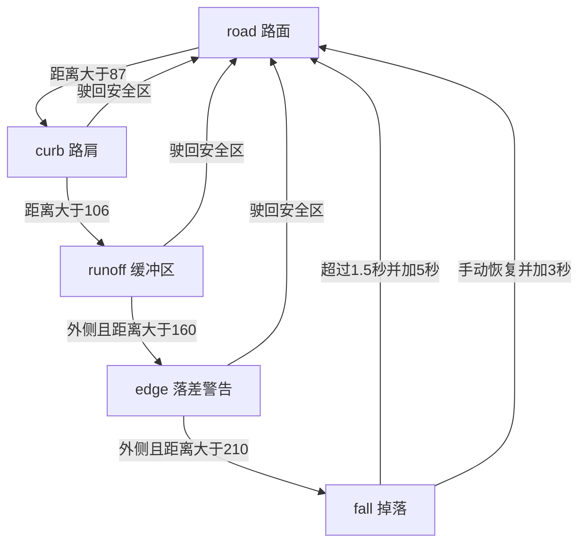
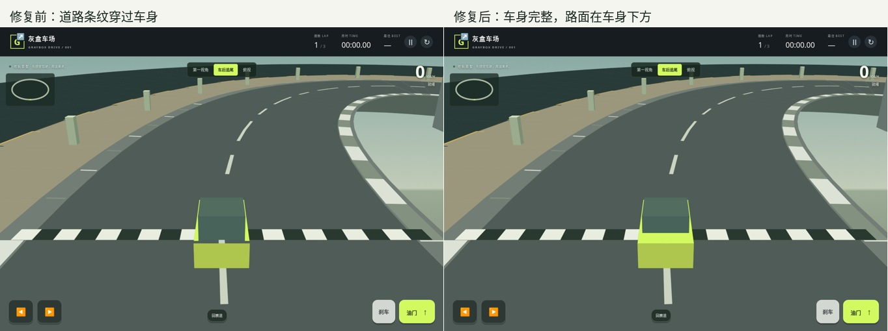

# 车辆状态机与截图验收

验证日期为2026年11月9日。代码有比赛流程和视角两组显式状态。车辆运动、路面、碰撞和反馈通过输入、位置、速度与计时器派生；这些状态可以同时存在。

## 状态清单

| 状态组 | 状态 | 转换条件与行为 | 已验证 |
| --- | --- | --- | --- |
| 比赛 | ready / running / paused / finished | 开始进入 running；暂停、失焦或后台进入 paused；继续保留本局；三圈结束进入 finished；重开清空本局 | 开始、暂停、继续、后台、结束、各状态重开、计时冻结 |
| 输入 | left / right / gas / brake 的16种组合 | 来源 Map 合并键盘和触点；一个来源释放不取消另一个；非运行和掉落时忽略驾驶按下事件 | 别名键、键盘与指针、同踏板双指、双指转向加速、取消、重复按键、全16组合 |
| 运动 | 静止、加速、滑行、刹车、倒车、倒车转前进、正反向转弯 | 刹车在低速时进入倒车；左右同时按下抵消；双踏板限制速度 | 每种状态均有横竖屏和三视角截图 |
| 路面 | road / curb / runoff / edge / fall | 最近中心线距离依次越过87、106、160、210单位；edge、fall要求位于赛道外侧 | 边界前后、返回安全路面、提示与减速 |
| 碰撞 | 未接触、低速分离、反弹、撞击反馈、冷却、反馈结束 | 接触半径15；朝向障碍运动时反弹；速度大于20且冷却为0时显示撞击；冷却0.8秒 | 正向与倒车撞击、低速接触、无重复反弹、冷却与提示消失 |
| 恢复 | 掉落初期、渐暗、暂停、自动恢复、手动恢复 | 掉落超过1.5秒自动回赛道并+5秒；手动回赛道+3秒；暂停冻结掉落；手动恢复取消后续自动处罚 | 处罚次数、停车、返回中心线、暂停继续、掉落中手动恢复 |
| 视角 | first / chase / top | 按钮或V切换；不修改比赛、位置、速度、危险状态 | 三视角、V重复、保存后重载、240处车身遮挡像素、建筑遮挡、掉落跟随 |
| 反馈 | 路面、撞击、掉落、恢复toast、比赛overlay | fall优先于impact，impact优先于路面；回到road后关闭危险提示 | 文案、可见性、黄框、尘土、红色反馈、渐暗、恢复、暂停和结束 |
| 保存 | 无最佳、首次成绩、更快更新、更慢保留；有效或无效视角 | localStorage保存最佳和视角；无效视角回退first；重开保留最佳 | 首次、重载、更慢保留、更快更新、无效视角回退 |

## 比赛流程

## 路面与掉落

一次较大的位置变化可以跨过中间状态。暂停属于正交的比赛状态，能冻结任何当前危险状态。

## 本次修复

1. 道路穿过车身。地面与立体物体混用面中心深度排序。现在先绘制地面，再对立体物体排序；座舱从车顶开始。赛道240处的车尾甲板像素由240处错误变为0处错误。建筑仍能正确遮挡车辆。
2. 输入来源互相覆盖。W与方向键上同时按住后，释放W会错误关闭油门。键盘和指针混用也会出错。现在每个来源独立持有动作，释放最后一个来源才关闭。
3. 追尾掉落画面异常。镜头下降而车辆高度固定，车辆会移出画面。现在车身、座舱和镜头共享下降高度，追尾俯角保持固定。第一视角原有掉落反馈保留。

## 证据与重跑

- `tests/drive.cjs`检查基础规则、计圈、恢复、投影和低帧率推进。
- `tests/browser-states.cjs`生成32种场景×3视角×2方向的192张截图，另加16种输入组合和2张事件证据，共210张。另有29项转换、事件、保存和像素检查。最终全部通过。
- `state-machines/results.json`保留逐项状态数值、截图文件名和检查结果。
- `contact-landscape-*.jpg`、`contact-portrait-*.jpg`是逐图视觉复核用总览。
- HTML报告包含全部原始截图，可按状态、视角和方向筛选，可放大及查看数值。

截图使用真实Chromium。为了覆盖难以稳定触发的分支，测试设置位置、圈数和时钟，再执行真实逻辑和Canvas绘制。另有真实键盘、鼠标和CDP触点事件。该验收不代表Android、iPhone真机或所有浏览器均已通过。
