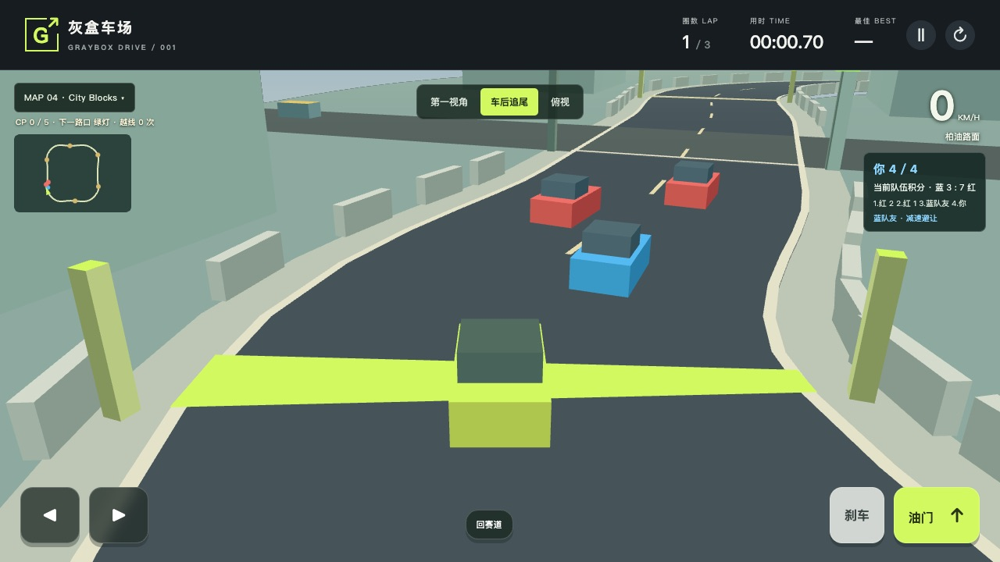
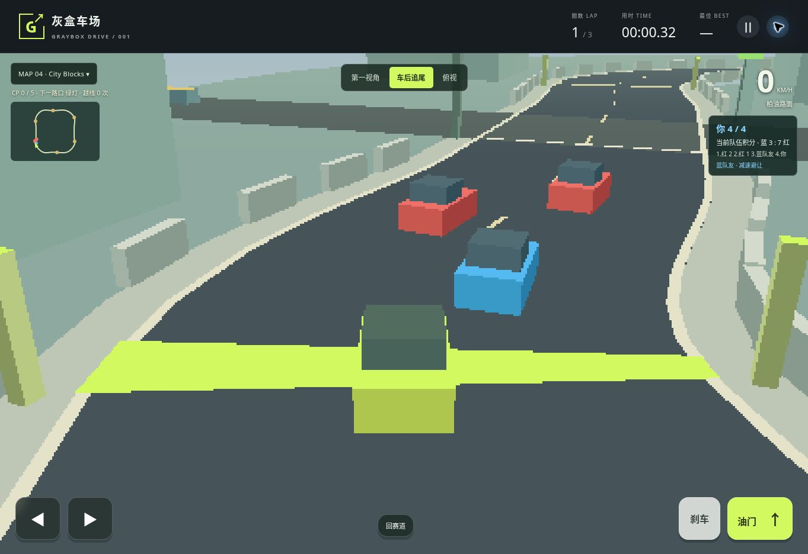

# Computer teammates and rivals

Date: 2026-11-10, Asia/Shanghai. Runtime `5996d4c` is published. The full pre-commit command, Linux CI verification, deployment and complete public-site verification all passed.

## Delivered behavior

The default race has four cars. The player and one blue computer teammate race against two red computer rivals on all five maps. Computer positions integrate steering and velocity. The route supplies look-ahead targets, road width, elevation, bends and obstacle locations. Normal driving does not snap cars back to the route.

The teammate yields to an approaching player behind it. Computers can pass a slow or stopped car ahead when either safe lane is free. Occupied lanes, city signals and cross traffic can require braking. Contacts separate bodies and change approaching velocities, with height and cooldown guards. Recovery returns to earned progress. Finished cars stop moving and leave the contact set.

The HUD shows four-car standings and current team points. Places award 4, 3, 2 and 1 points. Tied progress uses a stable ID order. The player finishing freezes the world. The result is explicitly the score at the player's finish, including the then-current progress of unfinished cars.

## Reproduced failures and fixes

| Failure | Root fix | Regression |
| --- | --- | --- |
| Offroad computers repeatedly hit a rock and recovered before earning a checkpoint | Choose an obstacle-free lane before steering, retaining physical obstacle contacts | All three computers complete every actual map with static objects present |
| City computers waited indefinitely behind the idle player despite an open lane | Allow the teammate to pass slow forward traffic and evaluate both road-frame lanes | Full game update with idle player and actual city traffic completes within the unchanged 400-second simulation bound |
| Initial browser test proved only startup | Observe at least ten simulation seconds without changing requestAnimationFrame on each map and viewport | Per-second positions, finite values, travel, route progress and recovery observations |
| NPC geometry could contaminate the existing player-only pixel probes | Use distinct NPC body dimensions and an independent top-view drawing function | Existing player silhouette and flicker checks continue to remove only the player |

## Verification layers

| Layer | Required evidence |
| --- | --- |
| Actual JavaScript | Existing physics, 4,096 input transitions, 26 hidden-state contracts and 25 computer-racer contracts |
| Finite TLA+ | Ten positive models, 24 specified mutation counterexamples and 1,084,054 distinct reachable states across the separate finite model graphs |
| Real Chromium | Existing complete scene, silhouette, camera and flicker suites, plus sustained default-team driving, real keyboard input, three cameras, both renderers, lifecycle and a raw recording |
| Exact source | Match runtime, model and verification SHA-256 values between the edited checkout, pre-commit runner and release artifacts |
| Public deployment | Full verification against the actual public game and SHA-256 comparison of every deployed dist asset |

The selected-actor computer model checks lifecycle, policy, recovery and contact cooldown. The four-racer model checks checkpoints, finish order, stable ranks and score conservation. Models are finite abstractions. They do not prove JavaScript refinement, continuous geometry, GPU behavior or physical-phone performance. The isolated controller route tests place the player away from the route and omit moving traffic. Separate full-game city and offroad cases retain the idle player and actual city traffic.

## Reproduction

Run the existing project command before committing:

```sh
.venv/bin/python tests/verify.py
```

After publishing the exact commit, repeat against production:

```sh
DRIVE_URL=https://liushiyumath.github.io/graybox-drive/ \
DRIVE_VERIFY_DIR=verification/latest-live .venv/bin/python tests/verify.py
```

The Work host's installed headless browser crashed during navigation; system Chromium also failed to create a required Unix socket. Actual Chromium tests run on the authorized Mac mini and in Linux CI. The Mac's first full attempt found an unset default Java runtime. Selecting its existing OpenJDK 21 fixes that environment prerequisite without changing or skipping any checks. Raw failed and successful runs remain separate.

## Release evidence

The full pre-commit run passed all 22 commands, with 532 screenshots, seven raw recordings, 93 computer-race browser checks and all 25 computer-racer runtime contracts. All 51 measured runtime, model and verification source hashes matched the candidate after execution. The normal-animation team cases each observed at least ten simulation seconds on all five maps at 1280×720 and 390×844. Desktop and portrait captures were visually reviewed for car identity, team colors, ranking labels and reachable controls.

[Pre-commit manifest](teams-precommit.json) · [TLC results and model hashes](teams-tla.json) · [Raw normal-animation recording](teams-driving.webm) · [Portrait capture](teams-phone.jpg)



The public site was also exercised in the shared cloud Chrome. Its visible HUD showed the new 2v2 roster and team points. Actual throttle reached 61 km/h in the captured driving frame and produced physical obstacle feedback. Pause held the displayed time across observations; resume, reset and camera switching responded. No game console errors were observed. The deployed capture is separate from the pre-commit images.



[Workflow 42768111878](https://github.com/LiuShiyuMath/graybox-drive/actions/runs/42768111878) completed with `verify`, `deploy` and `verify-live` all successful for [runtime commit 5996d4c](https://github.com/LiuShiyuMath/graybox-drive/commit/5996d4c6abddc92ce2adb5c2da27df967626884b). Linux verification and the full public-site rerun each retained 532 screenshots and seven recordings. The released game has eight dist assets. The live browser gate downloads and hashes every asset against the checked-out source.

[Release result and source-hash comparison](teams-release.json) records the exact artifacts and all 51 matching runtime, model and verification hashes across pre-commit, CI and live-site execution. Later documentation and screenshot updates preserve these tested sources.

Android and iPhone physical-device controls, Safari, Firefox and real-device frame rates remain unverified. The delivered feature is a playable graybox, with the finite model boundaries stated above.
